[TOC]

## Introduction

**fũnkplot** is a niche piece of mathematical modeling and plotting software, which is based on an interpreted descriptive language.

Using this programming language you can instruct **fũnkplot** to generate 2-dimensional plots to help you with your mathematic tasks.

After generation these plots and surfaces can be exported into various formats for further operations on them.

**fũnkplot** has python language bindings, it is possible to run python scripts on your generated data to further enlarge the interoperability of data between various programming platforms.

## First steps

After the installation when you have started **fũnkplot** it will be possible to load a few samples (from the samples directory) or just type in and run your program to see the generated plot in the plotting area.

### The **fũnkplot** programming language

**fũnkplot** uses its own programming language influenced by **basic** in its simplicity, with some extensions to allow more complex mathematical notions to be easily handled, and having a decent enough verbosity to feel like a natural language.

The process of creating a plot is very straightforward, just write a small program and run it. One of the most simple ones would take up just the following 2 lines:

```
function f(x) = sin(x)
plot f over (-5, 5)
```

And this will generate the following plot:

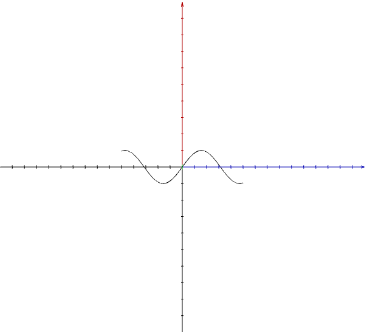

**fũnkplot** supports a range of built-in mathematical functions, most of the default operators and has syntax for changing the color, line and rotation of the current plot.

## A generic **fũnkplot** program

It is recommended, but not mandatory that the **fũnkplot** programs adhere to the following structure:

```python
# generic scene settings
# variable delcarations
# function declarations
# variable initialization
# code
```

This makes possible that the function declaration will use variables without raising an error of undefined variables and that all logical blocks of the program that belong in one place are grouped together.

The generic scene settings deal with parts of the program that for simple scenarios contain settings that affect the whole of the scene, such as the size of the pixels, or whether the coordinate system is visible or not, or the palette used.

The variable declarations declare the variables that will be used in the program, it is preferred to keep one line declarations.

The function declaration contain the functions that will be used in the program, it is possible to have more than one function.

In the variable initialization block you have to initialize the variables. Uninitialized variable don’t play well with the program.

Then finally in the code section you can start playing with the function.

Lines starting with the `#` symbol are considered comments and are ignored by the interpreter.

## Keywords

The following are the keywords recognized by the **fũnkplot** interpreter.

| Keyword    | Description                                                  |
| :--------- | ------------------------------------------------------------ |
| `append`   | Will append a value to the given list.                       |
| `draw`     | Draws geometric objects: points, segments, lines and angles. |
| `if`       | Checks for a condition and executes the given block of code in case of a statement which evaluates to non zero. It can have an `else` branch, and ends with `done`. |
| `for`      | Creates a loop for traversing over a set of data. The loop can be numeric loop with indexes or looping through a list of points. The body of the loop ends with `done`. |
| `function` | Defines a function that can be used in plotting or experimenting. |
| `let`      | Defines the value for the given variable.                    |
| `parametric` | Defines a parametric function, see the `function` keyword. |
| `plot`     | Plots the given function or list of points.                  |
| `polar`    | Placed before `plot`, interprets the plotted function in polar coordinates. |
| `rotate`   | Rotates the given point(s) around a given point with a specific angle. |
| `python`   | Runs a python script (`python script begin` … `end`), or a single python statement (`python do …`). |
| `set`      | Sets variables altering the behaviour and visualization of the scene. |
| `var`      | Declares a variable.                                         |

Lines starting with `#` are comments. The words `of`, `over`, `counts`, `step`, `continuous`, `to`, `in`, `range`, `do`, `with`, `around`, `at`, `as`, `on`, `from`, `through`, `and` and the other words described on the pages of the individual keywords complete these statements.

### The **append** keyword

You can append values to lists using the `append` keyword. It’s generic format is:

```
append to <list_variable> <numbers|points> <number,number,...|(point1x,point1y),(point2x,point2y),...>
```

And the following are two short examples on how to use it:

```
append to list_variable numbers 1,2,3,4
append to list_variable points (1,2),(3,4)
```

#### Example for numbers

The following program

```
var l list of numbers

let l = list[1,2,3,4]
python do print(l)

append to l numbers 5,6,7
python do print(l)
```

will generate the following output

```
[1.0, 2.0, 3.0, 4.0]
[1.0, 2.0, 3.0, 4.0, 5.0, 6.0, 7.0]
```

#### Example for points

The following program

```
var l list of points
var i number
let l = list[]

for i = 0 to 5 step 0.5 do
  append to l points (i, i)
done

set pixel size 6
plot l
```

Will generate the following plot:

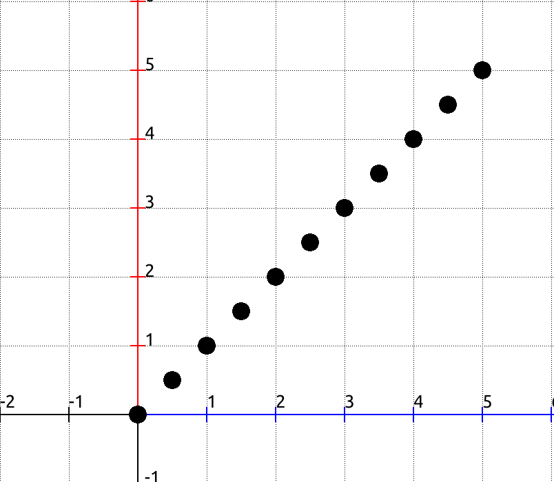

### The **if** keyword

The `if` keyword is used to execute a block of code depending on the value of an expression. The generic form of `if` is:

```
var i number
let i = 4
if i == 4 do
  python script begin
    print(i)
  end
done
```

This will declare a variable`i`, and assign the value `4` to it, upon execution it will print the value to the output window:

```
4.0
```

The `if` can have an `else` branch too:

```
set pixel size 4
var ps list of points
var i number
function f(x) = x
let ps = points of f over (0, 1) counts 16
for i = 0 to 15 do

  if i % 2 == 0 do
    set color red
  else
    set color blue
  done

  plot ps[i]
done
```

This will generate the following plot:

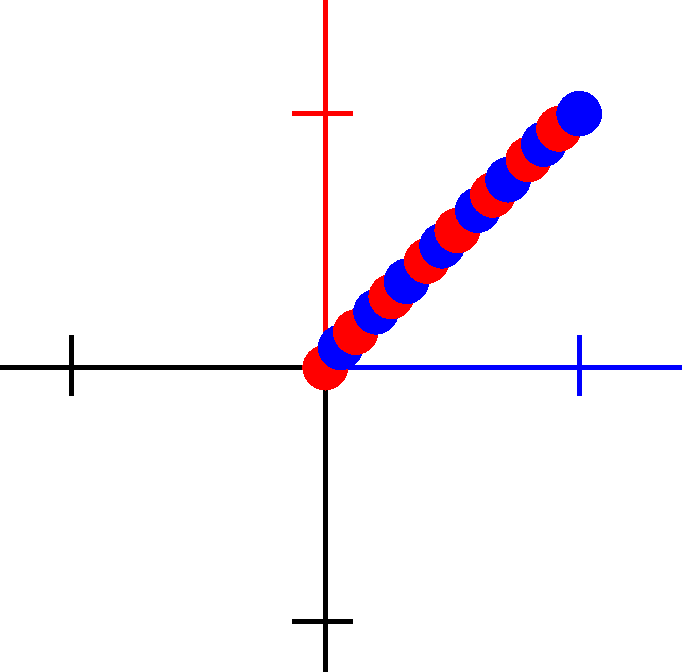

### The **for** keyword

The `for` keyword is used to declare a loop that will execute a block of code a specific time. There are two forms a `for` loop can take in **fũnkplot**. The first one is a standard numeric loop:

```
var i number
for i = 1 to 5 do
  python script begin
    print(i)
  end
done
```

This will declare a variable `i`, and execute the body of the loop 5 times, which is calling a one line python script printing the value of i. The loop variable has to be declared before the loop. The output should look like:

```
1.0
2.0
3.0
4.0
5.0
```

By default the loop variable is increased by `1`, a different increment can be specified with the `step` keyword:

```
var i number
var p point
for i = 0 to 2 step 0.5 do
  let p = point at (i, i)
  plot p
done
```

#### Looping through a range

The same numeric loop can be written with the `range` keyword, where the start and the end values are given in parentheses, optionally followed by a `step`:

```
var i number
var p point
for i in range (0, 5) step 1 do
  let p = point at (i, i * i / 5)
  plot p
done
```

#### Looping through a list

The other form of the `for` loop is when looping through a list. This looks like:

```
var i number
var l list of numbers
let l = list [1,5,10,15]
for i in l do
  python script begin
    print(i)
  end
done
```

This will generate the following output:

```
1.0
5.0
10.0
15.0
```

#### Looping through the points of a function

The `for` loop can be used to loop through the points of the plot of a function, and it will make possible to perform various operations on individual points, like in the example below:

```
set pixel size 2
var a number
var p point
var ps list of points

function f(x) = x * sin(x)

let ps = points of f over (-2,2) counts 360
let a = 0

set color blueviolet
for p in ps do
  rotate p with a degrees
  let a = a + 1
  plot p
done

set color brown
plot ps
```

This will generate the following image:

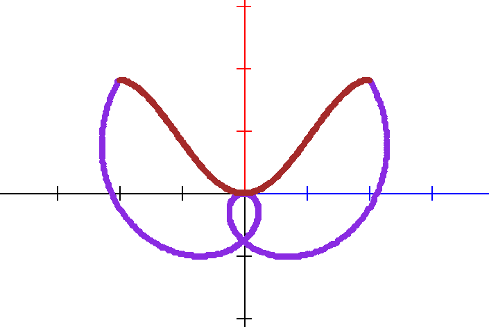

### The **function** keyword

The `function` keyword is used to declare the mathematical functions you intend to plot. The syntax is:

```
function f(x) = expression
```

Functions can have more than one parameter, separated by commas, for example `function f(x, y) = (x + y) / 3`. Parameter names must be valid identifiers: a letter or `_` followed by letters, digits or `_`.

The expression might consist of any of the following terms, even combined with one another:

- mathematical operators:
  - `+` (addition)
  - `-` (subtraction)
  - `/` (division)
  - `*` (multiplication)
  - `%` (modulo)
  - `^` (power)
- parentheses `(` and `)` to denote the precedence of operations
- algebraical and trigonometrical functions:
  - `sin` (The sine function)
  - `cos` (The cosine function)
  - `tan` (The tangent function)
  - `cot` (The cotangent function)
  - `sec` (The secant function)
  - `cosec` (The cosecant function)
  - `asin` (The arcsine function)
  - `acos` (The arccosine function)
  - `atan` (The arctangent function)
  - `actg` (The arc-cotangent function)
  - `asec` (The arcsecant function)
  - `acosec` (The arc-cosecant function)
  - `sinh` (The hyperbolic sine function)
  - `cosh` (The hyperbolic cosine function)
  - `tanh` (The hyperbolic tangent function)
  - `coth` (The hyperbolic cotangent function)
  - `exp` (The exponential function)
  - `log` (The common logarithmic function)
  - `ln` (The natural logarithmic function)
  - `sqrt` (The square root function)
  - `abs` (The absolute value)
  - `sgn` (The sign function: `-1`, `0` or `1`)
  - `inc` (Adds one to its argument)
  - `dec` (Subtracts one from its argument)
- another function you have declared with one parameter, for example `function f(x) = g(x) + 1`
- a variable defined in the `var` section of the application
  - This situation will bind a reference to the variable into the body of the function, so each evaluation of the functions’ values reflects the state of the variable used in it
  - The coordinates of a point variable can be accessed with `.x` and `.y`, such as `p.x`, and the elements of a list with an index, such as `ps[2].y`

The order of evaluation of the operators is a mathematical one.

It is possible to declare more than one function in a program.

#### Powers of functions

A built-in function can be raised to a power by writing the power after the name of the function, as is customary in mathematics. The following two functions are identical:

```
function f(x) = sin^2(x) + cos^2(x)
function g(x) = sin(x)^2 + cos(x)^2
```

#### Constants

The following constants can be used in expressions:

| Constant      | Value                                        |
| ------------- | -------------------------------------------- |
| `pi` or `π`   | 3.141592653589793                            |
| `e` or `ℯ`    | 2.718281828459045 (unless a parameter of the function is called `e`) |

Also, the superscript `²` is understood as a power of two, so `x²` is the same as `x^2`.

#### Comparisons and logical operations

Expressions can contain the comparison operators `==`, `!=`, `<`, `<=`, `>` and `>=`, and the logical operators `and`, `or` and `not`. A comparison evaluates to `1` if it is true and to `0` otherwise. `not` binds weaker than the comparisons, so `not x > 0` means `not (x > 0)`, `and` binds stronger than `or`, and parentheses can be used to change the order. These are mostly useful in the conditions of the `if` statement, but they can be used in functions too, even as a part of an arithmetic expression:

```
function f(x) = x > 0 and x < 1 or x == 2
function g(x) = (x % 2 == 0) * 10 + not(x > 5)
```

#### Example

The following code plots a colourful Lissajous curve by defining two functions:

```
set palette firestrm
set pixel size 5

var pssin pscos list of points
var i x y number
var ps pc p point
let i = 0
function ps(x) = 2 * sin(3 * x + 3.14/2)
function pc(x) = 3 * sin(2 * x)

let pssin = points of ps over (-3.14, 3.14) counts 256
let pscos = points of pc over (-3.14, 3.14) counts 256

for i = 0 to 255 do

  let ps = pssin[i]
  let pc = pscos[i]

  let x = ps.y
  let y = pc.y

  let p = point at (x,y)
  set color palette[i]
  plot p

done
```

Resulting in the following plot:

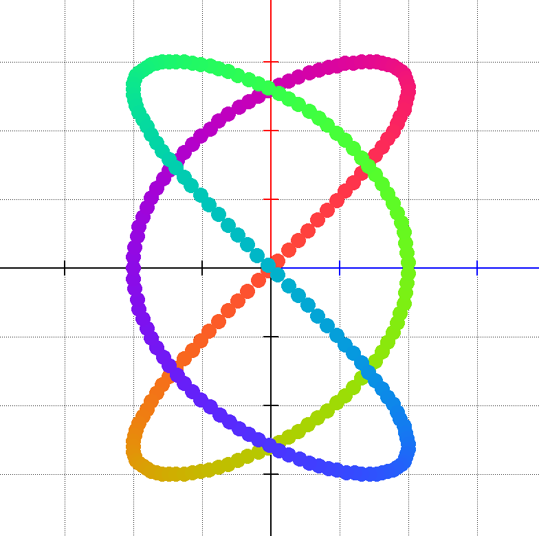

#### Parametric functions

A parametric function defines the `x` and `y` coordinates of a curve separately, as functions of one parameter. It is declared with `parametric function`, followed by one line for each coordinate, and closed with `end` (or `done`):

```
parametric function name(t)
  x = expression of t
  y = expression of t
end
```

Only the coordinates `x` and `y` are supported in the body. A parametric function can be plotted, or its points can be assigned to a list, just like the points of a normal function. The following program draws an astroid:

```
var a number
let a = 2
parametric function f(t)
  x = a * cos^3(t)
  y = a * sin^3(t)
end
plot f over (-3.14, 3.14)
```

### The **let** keyword

The `let` keyword is used to make an assignment to a declared variable. It’s basic syntax is:

```
var a number
let a = 1.2
```

This will assign the value `1.2` to the variable `a`, which was declared to be of type `number`. It will raise a syntax error to assign to a variable which was not declared, or if the type is different.

It is possible to assign arithmetic expressions to numeric type variables, so the following is syntactically correct:

```
var a b c number
let a = 1.2
let b = 2.3
let c = a + b
```

#### Creating a point

The `let` keyword is also used to create a point on the scene.

The following assignment assigns to the `point` type variable called `p` the point at `(1,2)` and plots it, the result is a small dot, indicating the point has been drawn.

```
var p point
let p = point at (1,2)
plot p
```

##### Naming a point

Any point assignment can be followed by `as "NAME"` to attach a label that will be drawn next to the point on the scene:

```
var p point
let p = point at (1, 2) as "P"
plot p
```

The label is drawn in an italic serif font to match conventional mathematical notation. If the name ends with one or more digits, those digits are rendered as a subscript automatically — so `"P1"` appears as *P* with a small *1* below the baseline, `"A12"` as *A* with *12* below, and so on.

```
var p1 p2 point
let p1 = point at (-2, 0) as "P1"
let p2 = point at ( 2, 0) as "P2"
plot p1
plot p2
```

When two or more named points share the same screen position their labels are stacked vertically so they do not overlap.

The `as "NAME"` suffix works on all point-producing forms of `let`, not only `point at`:

```
let p = point on s at 25% from start as "A"
let q = point on s at t 0.5         as "M"
let r = point on s at x 3           as "R1"
let i = point at intersection of s1 and s2 as "I"
let m = midpoint of s as "M"
let q = point p reflected across s as "Q"
```

##### Copying a point

A point can be assigned from another point, or from an element of a list of points. The coordinates of a point can be used in arithmetic expressions with `.x` and `.y`:

```
var p q point
var ps list of points
var a number
function f(x) = x * x
let ps = points of f over (-2, 2) counts 10
let p = ps[3]
let q = p
let a = q.x + q.y
```

##### Geometric constructions

Many more point, segment, line and number assignments are available for geometric constructions, such as the point on a segment, the intersection of two lines, the reflection of a point, the distance between two points or the length of a segment. These are described in the Geometric objects section of this help.

#### The points of a function

The `let` keyword can be also used to assign the points of a drawable object (such as a function) to a variable which can be manipulated in various ways.

The following piece of code will create such a variable:

```
var ps list of points
function f(x) = sin(x)
let ps = points of f 
plot ps
```

and running it will result in the following drawing:

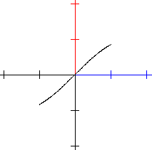

The algorithm operating on the default interval `[-1, 1]` is a simple iterative one, that starts `x` from the first point in the default drawing interval (`-1`) till the end of the default drawing interval (`1`) and will use a default step of `0.01` for advancing the function drawing, while calculating the value `f(x)` as per the mathematical formula of the function.

##### Advanced points assignment

Since there can be situations where we want to plot functions outside of the default `[-1, 1]` interval, the `let` keyword accepts extra parameters too, specifying the interval, the number of points or segments we want to draw and whether we want to plot using points of function or a continuous drawing.

###### Specifying the interval

The following example specifies the interval which is to be used to draw the function:

```
var ps list of points
function f(x) = sin(x)
let ps = points of f over (-3.14, 3.14)
plot ps
```

and results in the following plot:

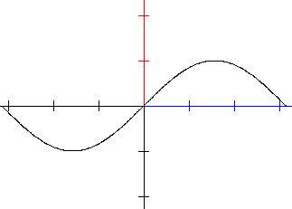

###### Specifying the number of points in a plot

It is possible to specify how many points should a drawing contain to have a better control over your data using the `counts` keyword. The following example specifies the number of points that will be used to draw the function:

```
var ps list of points
function f(x) = sin(x)
let ps = points of f over (-3.14, 3.14) counts 24
plot ps
```

and results in the following plot:

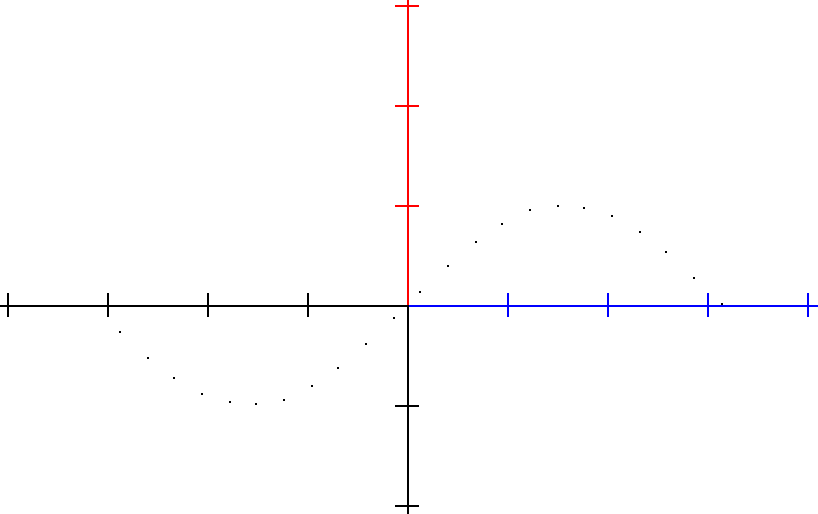

This approach will calculate the step value considering the length of the interval to obtain the required number of points.

###### Specifying the step used in a plot

It is possible to specify the step used when drawing the plot of the function using the `step` keyword. The following example specifies the steps that will be used to draw the function:

```
var ps list of points
function f(x) = sin(x)
let ps = points of f over (-3.14, 3.14) step 0.1
plot ps
```

and results in the following plot:

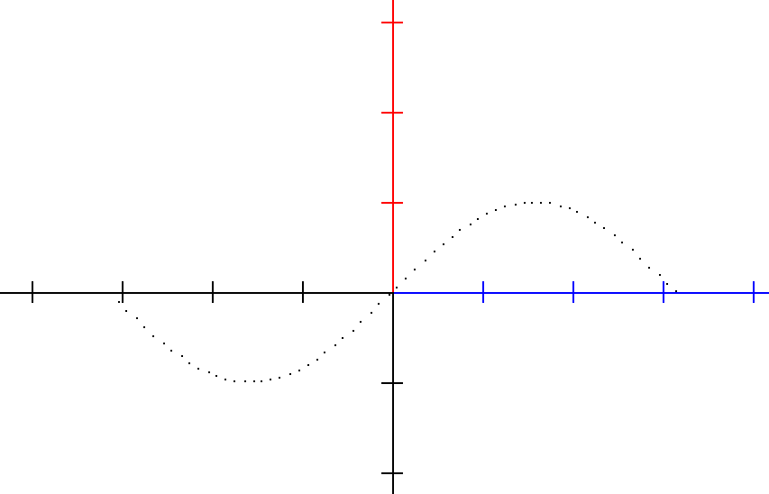

Since the step is calculated based on the number of points, it is not possible to specify both the steps and the number of points.

The points of parametric functions, segments and lines can be assigned the same way, for example `let ps = points of s counts 10` for a segment `s`. For lines, which are infinite, the interval has to be specified with `over`.

#### A list of numbers

A list of numbers is assigned with the `list` keyword, followed by the numbers in square brackets. Individual elements can be changed by indexing the variable, the index of the first element is `0`:

```
var xs list of numbers
let xs = list [1, 2, 3, 4]
let xs[2] = 9
```

#### A list of points

The `let` keyword can be used to make an assignment to a list of points by using predefined values. The points can be separated by `;` or `,`.

```
var ps list of points
let ps = list [(1,2);(3,4)]
```

This will assign the two points at `(1,2)` and `(3,4)` to the `ps` variable. An empty list can be created with `let ps = list[]`, and points can be added to it later with the `append` keyword.

#### Assigning an Angle

Angle variables store a rotation in radians internally but can be entered and displayed in degrees.

##### Literal angle value

The simplest form assigns a numeric literal; with no unit the value is interpreted as **degrees**:

```
var alpha angle
let alpha = 45
```

The unit keyword can be given explicitly:

```
let alpha = 45 degrees
let alpha = pi/4 radians
```

Any arithmetic expression is accepted as the value:

```
let alpha = 360 / 8 degrees
```

##### Angle of a segment

Assigns the direction angle of a named segment — the angle that the segment makes with the positive x-axis, computed as `atan2(y2−y1, x2−x1)`:

```
var s1 segment
var alpha angle
let s1 = segment from (0, 0) to (3, 4)
let alpha = angle of s1
```

##### Angle between three points

Computes the interior angle at the middle (vertex) point, formed by three named points. The result is always in the range [0°, 180°]:

```
var p1 p2 p3 point
var beta angle
let p1 = point at (0, 0)
let p2 = point at (3, 0)
let p3 = point at (3, 4)
let beta = angle p1 p2 p3
```

This uses the dot-product formula: `arccos((v1 · v2) / (|v1| |v2|))` where `v1 = p1 − p2` and `v2 = p3 − p2`.

### The **plot** keyword

The `plot` keyword is used to draw the graphical representation of an expression. The colour, and the pixel size for the plot can be specified using the `set` keyword.

#### Plotting a point

The following program plots one point on the screen:

```
set color darkgreen
set pixel size 4
var p point
let p = point at (1, 2)
plot p
```

Generating the following plot:

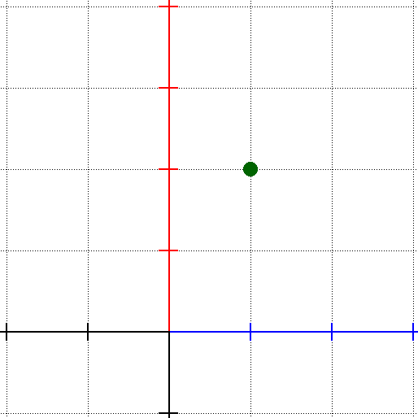

#### Plotting a function

The following code plots the function `sin(x)` over the interval `(-π, π)`.

```
function f(x)=sin(x)
plot f over (-3.14, 3.14)
```

For plotting functions it is possible to specify the plot interval and the type of the plot (ie. a continuous plot, the increase step or the number of points used to represent the drawing):

| Specifier          | Meaning                                                      |
| ------------------ | ------------------------------------------------------------ |
| `over (a, b)`      | The interval of the plot.                                    |
| `continuous`       | Connects the calculated points with lines, instead of drawing them as separate points. |
| `counts N`         | Uses `N` points, evenly distributed over the interval.       |
| `step S`           | Advances with `S` between two calculated points.             |

If there is no plot interval, the default interval of `(-1, 1)` is used. If there is no step or point count defined the default step of `0.01` is used.

The program above will generate the following image:

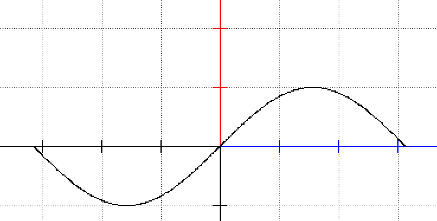

#### Plotting an expression directly

It is not necessary to declare a function in order to plot it. A built-in function can be plotted by its name, and any expression can be plotted with the `for` specifier, which names the variable of the expression (if there is no `for`, the variable is `x`):

```
plot sin over (-3.14, 3.14) continuous
plot x^2 - 1 for x over (-2, 2) continuous
plot sin(t) * t for t over (-6, 6) continuous
```

Built-in functions written without parameters are applied to the variable, so `plot sin * x for x over (-3, 3)` is the same as `plot sin(x) * x for x over (-3, 3)`.

#### Plotting a parametric function

Parametric functions (see the `function` keyword) are plotted the same way as normal functions, the interval refers to the parameter of the function:

```
parametric function f(t)
  x = 2 * cos(t)
  y = sin(t)
end
plot f over (0, 6.28)
```

#### Plotting geometric objects

Points, and also `segment` and `line` variables can be plotted with `plot`. Points that were given a name with `as "NAME"` are plotted together with their label. More options for geometric objects are available with the `draw` keyword, see the Geometric objects section of this help.

```
var p point
var s segment
let p = point at (1, 1) as "P"
let s = segment from (0, 0) to (4, 2)
plot p
plot s
```

#### Plotting the points of a function

It is possible to plot the points of a function while iterating over them with an index counter, or by point reference.

```
set pixel size 2
var p point
var ps list of points

function f(x) = sin(x)

let ps = points of f over (-3.14, 3.14)

for p in ps do
  plot p
done
```

Generating the following plot:

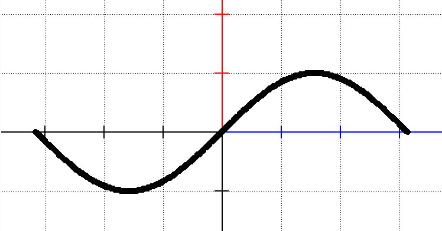

#### Plotting polar data

**funkplot** can interpret the data to be plotted as a series of polar data if you precede it with the `polar` keyword. The following program:

```
set pixel size 3
function f(x) = 5* sin(3 * x) 
polar plot f  over (0, 6.28) continuous
```

will generate the following graph:

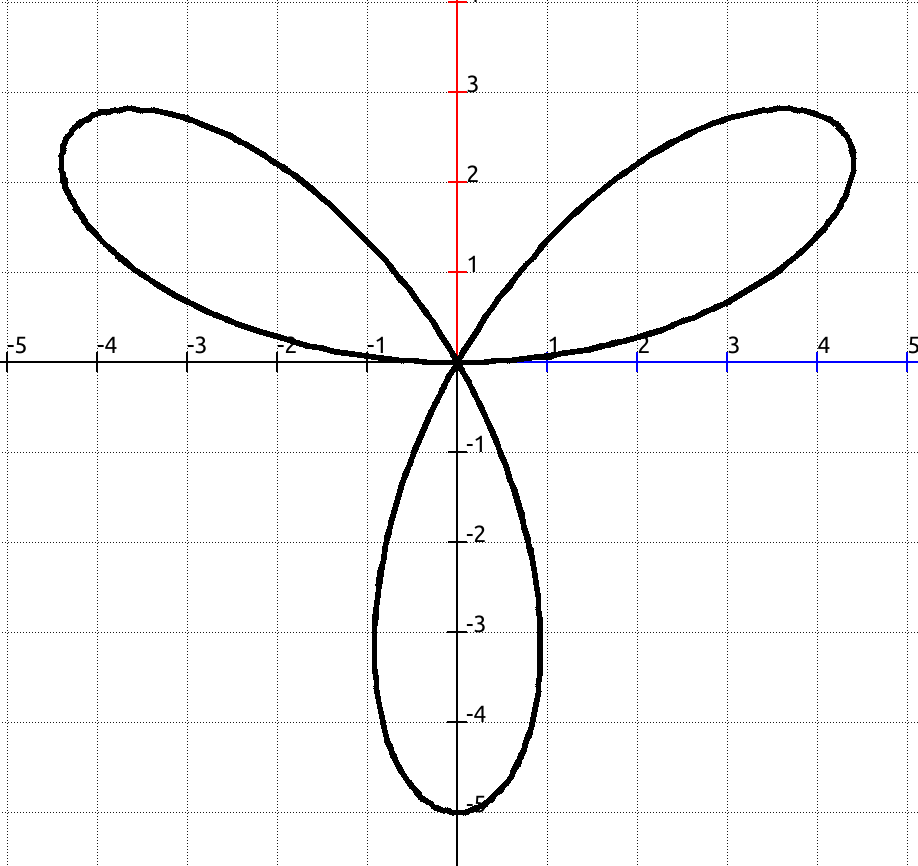

### The **rotate** keyword

It is possible to rotate some of the objects found in **fũnkplot** applications. The following syntax is used to achieve this:

```
rotate <object> with <V> [degrees|radians] [around point at (x, y)]
```

Where

- `object` is the object that needs to be rotated. It can be either a point or a list of points.
- `V` is the value we are rotating the object with
- It is possible to optionally specify whether the given value is `radians` or `degrees`. If nothing is specified, the default is `degrees`.
- By default the rotation happens around the origin of the coordinate system. With `around point at (x, y)` the object is rotated around the given point:

```
var p point
let p = point at (1, 0)
rotate p with 90 degrees around point at (2, 2)
plot p
```

The following program:

```
set palette afternoon_heat
set pixel size 2

# variable declarations
var i number
var ps list of points
var p point

# the function to plot   
function f(x) = sin(x)

# the actual code 

let ps = points of f over (-3.14, 3.14) counts 360
for i = 0 to 255 do
  let p = ps[i]
  set color palette[i]
  rotate p with i degrees
  plot p
done

```

Generates the following plot:

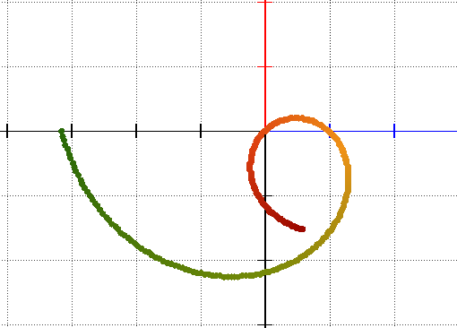

While the following program:

```
var l list of points
var i number
let l = list[]
for i = 0 to 5 step 0.1 do
  append to l points (i, i)
  set pixel size 12 - 2 * (i + 1)
  rotate l with 10 degrees
  set color i * 25, i * 10, i * 10
  plot l
done
```

Generates the following plot:

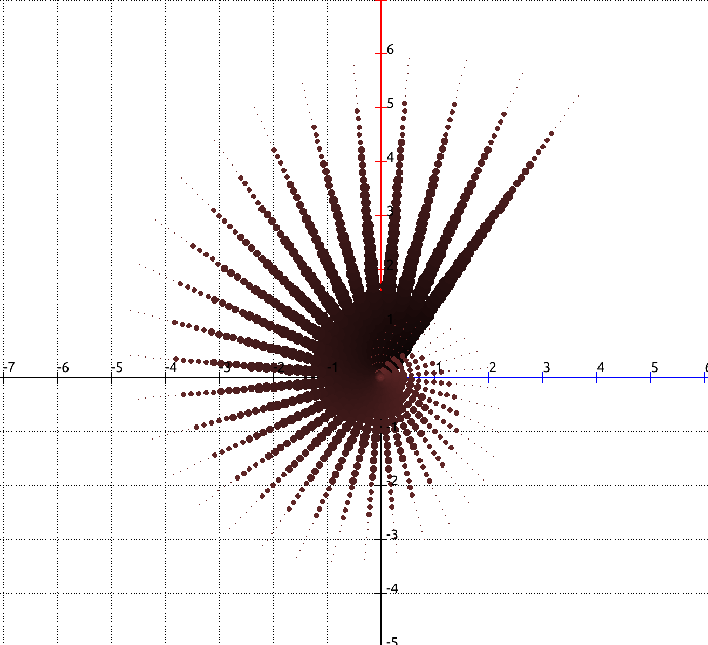

### The **script** keyword

It is possible to embed python scripts in **fũnkplot** code, if **fũnkplot** was built with python support (the `ENABLE_PYTHON` build option, which is on by default). The following syntax is used to insert a block of python scriptlets:

```
python script begin
#
# proper python code
#
end
```

And the following is to run one line python commands:

```
python do <a valid python statement>
```

The python script will have access to the variables defined in the **fũnkplot** code in the following manner:

- Variables with the type `number` will be treated as python floating point types.
- For variables with type `point` a new type is created, called `Point` and it is introduced in the python propgram, having a simple structure with `x` and `y` members:

```python
class Point(object):
    def __init__(self, x, y):
        self.x = x
        self.y = y
```

- All the variables that are in the **fũnkplot** program are added as an extra codeline before the script is copied over.

#### Example

##### Python block

```
var i number
var p point
var ps list of points
var ns list of numbers

function f(x) = sin(x)

let i = 0
let p = point at (1,2)
let ps = points of f counts 6
let ns = list [1,2,3,5,8,11]

python script begin

print("i=", i)
print("p=(", p.x, ",", p.y, ")")
l = 0
while l < len(ps):
  print("ps[",l,"]=(", ps[l].x, ",", ps[l].y, ")")
  l += 1

for l in range(len(ns)):
  print(ns[l])

end
```

Will generate the following python script:

```python
class Point(object):
    def __init__(self, x, y):
        self.x = x
        self.y = y
ps=[Point(-1.000000, -0.841471),Point(-0.600000, -0.564642),Point(-0.200000, -0.198669),Point(0.200000, 0.198669),Point(0.600000, 0.564642),Point(1.000000, 0.841471)]
p=Point(1.000000, 2.000000)
ns=[1.000000, 2.000000, 3.000000, 5.000000, 8.000000, 11.000000]
i=0.000000

print("i=", i)
print("p=(", p.x, ",", p.y, ")")
l = 0
while l < len(ps):
  print("ps[",l,"]=(", ps[l].x, ",", ps[l].y, ")")
  l += 1

for l in range(len(ns)):
  print(ns[l])
```

And the following output when executed:

```
i= 0.0
p=( 1.0 , 2.0 )
ps[ 0 ]=( -1.0 , -0.841471 )
ps[ 1 ]=( -0.6 , -0.564642 )
ps[ 2 ]=( -0.2 , -0.198669 )
ps[ 3 ]=( 0.2 , 0.198669 )
ps[ 4 ]=( 0.6 , 0.564642 )
ps[ 5 ]=( 1.0 , 0.841471 )
1.0
2.0
3.0
5.0
8.0
11.0

```

##### One line python

```
python do print("Hello Python") 
```

With the following output when executed:

```
Hello Python
```

### The **set** keyword

The `set` keyword is used to set variables altering the behaviour of the rendered scene. It is recommended to place the scene altering code sequences before any of the other code sequences.

The following values can be set:

| Setting        | Description                                                  |
| -------------- | ------------------------------------------------------------ |
| colour / color | Sets the colour of the next pixel to be drawn. Both UK and US spellings are allowed. |
| palette        | Sets the palette to be used for drawing the scene.           |
| coordinates    | Sets the properties of the coordinate system.                |
| pixel          | Sets the properties of the next pixel to be drawn.           |
| labels         | Turns the drawing of labels `on` or `off`.                   |
| label          | Sets the placement of the labels drawn next to named points and segment endpoints. |

#### Setting the colour

Setting the colour can be done using one of the following available syntaxes:

##### By name

Using the syntax `set colour name` sets the colour based on the name of it, using 255 as alpha value. A list of all colour names is available in the Miscellaneous section of this help system.

##### By name and alpha

Using the syntax `set colour name,alpha` sets the colour based on the name of it, using the specified alpha value.

##### From a palette

Using the syntax `set colour palette[index]` will make possible to set the colour with the given index from the palette that was selected with the `set palette …` statement, and will use the alpha channel set to 255. If there is no such palette found this statement has no effect and the colour black will be used.

##### From a palette with alpha value

Using the syntax `set colour palette[index],alpha` will make possible to set the colour with the given index from the palette that was selected with the `set palette …` statement and will calculate the alpha from the specified value. If there is no such palette this statement has no effect and the colour black will be used.

##### By RGB code

Using the syntax `set colour #<value>` will allow you to directly set the red, green and blue values of the colour using the well know HTML syntax. The following combinations are accepted:

- three digit colour code **RGB** : `set colour #123`.  Will set the specified colour with the alpha channel set to 255.
- six digit colour code **RRGGBB**: `set colour #112233`. Will set the specified colour with the alpha channel set to 255.
- eight digit colour code **RRGGBBAA**: `set colour #11223344`. Will set the specified colour with the specified alpha value.

##### By red, green and blue values

Using the syntax `set colour r, g, b` sets the colour from its red, green and blue components, and `set colour r, g, b, a` also sets the alpha value. The components can be any expression. Values between `0` and `255` are used as they are, while values smaller than `1` are considered to be a fraction of `255`, so `set colour 0.5, 0.5, 0` is the same as `set colour 127, 127, 0`. For the alpha value, `1` also means fully opaque.

```
var i number
for i = 0 to 5 step 0.1 do
  set color i * 25, i * 10, i * 10
done
```

#### Setting the palette

The syntax `set palette name` sets the palette that can be accessed in a `set color palette[index]` statement. A list of available palettes can be found in the Miscellaneous section of this help system.

#### Setting the properties of the coordinate system

It is possible to modify the properties of the coordinate system, such as the bounding box of it, the rotation and the zoom, or to hide the coordinate system if desired. The following table lists the values that can be changed.

| What         | Description                                                  | Example                               |
| ------------ | ------------------------------------------------------------ | ------------------------------------- |
| `on` / `off` | Shows or hides the coordinate system. The coordinate system by default is shown so you might consider hiding it if you wish. | `set coordinates off`                 |
| `start x`    | Sets the start value of the coordinate systems’ X axis.      | `set coordinates start x -4`          |
| `start y`    | Sets the start value of the coordinate systems’ Y axis.      | `set coordinates start y -4`          |
| `end x`      | Sets the start end of the coordinate systems’ X axis.        | `set coordinates end x 4`             |
| `end y`      | Sets the end value of the coordinate systems’ Y axis.        | `set coordinates end y 4`             |
| `zoom`       | Sets the zoom used on the coordinate system. The optimal value is depending on your screen resolution. | `set coordinates zoom 110`            |
| `rotation`   | Sets the rotation of the coordinate system. The value can be either degrees or radians (default). | `set coordinates rotation 45 degrees` |
| `grid`       | Shows or hides the grid of the coordinate system. By default the grid is visible, so you might consider hiding it. Accepts `on` or `off` as parameter. | `set coordinates grid off`            |

Due to the way the presentation of data is handled in the application, the statements affecting the behaviour of the coordinate system are executed before any other code is executed, so it is recommended to group the before any other statements

#### Setting the pixel properties

For the moment it is possible to set the size of a pixel with the command `set pixel size X` where X denotes an expression that will be evaluated.

#### Setting the labels

Points and segment endpoints can be given a name with `as "NAME"`, which is drawn next to them. The drawing of these labels can be turned off and on again with:

```
set labels off
set labels on
```

The position of the labels can be changed with the `set label` statement:

| Statement                                            | Description                                                  |
| ---------------------------------------------------- | ------------------------------------------------------------ |
| `set label position <direction>`                     | Sets where the label is drawn relative to the point. The direction is one of `before`, `after`, `above`, `below` (or `under`), or `angle <value>`, optionally followed by `degrees` (the default) or `radians`. |
| `set label distance close` / `far`                   | Draws the labels closer to (6 pixels), or farther from (22 pixels) the point. The default distance is 12 pixels. |
| `set label first <direction> second <direction>`     | Sets the position of the labels of the two endpoints of the segments drawn with `draw segment`. |

The Label placement section of this help describes these settings in detail.

#### Example

The following program sets the basic properties of the coordinate system and then draws a colourful line with increasing pixel sizes.

```
set coordinates start x -4
set coordinates start y -4
set coordinates end x 4
set coordinates end y 4
set coordinates zoom 110
set coordinates rotation 45 degrees

set palette precolombinas

var ps list of points
var i number

function f(x) = x
let ps = points of f over (-2, 2) counts 256

for i = 0 to 255 do
  set pixel size i/3+4
  set colour palette[255-i]
  plot ps[i]
done
```

Resulting in the following plot:

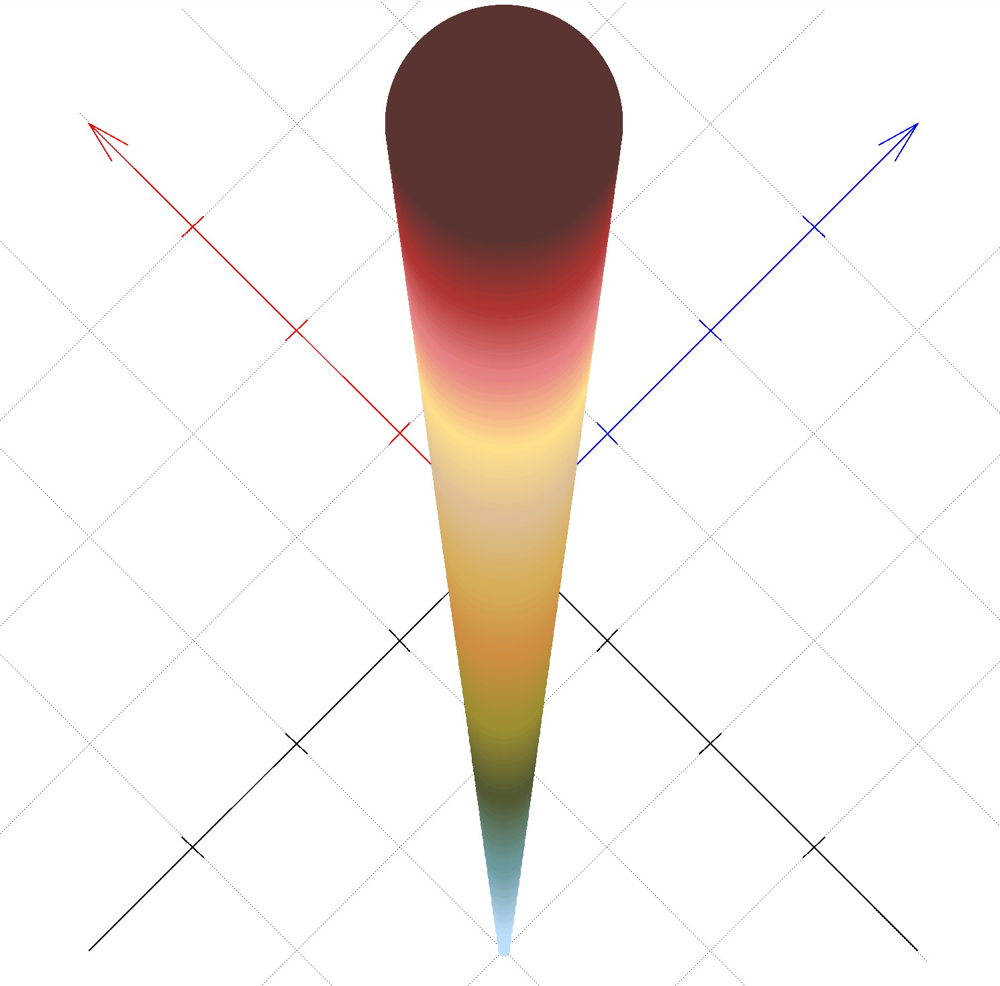

### The **var** keyword

The `var` keyword is used to declare variables that later can be used to perform various operations with. The syntax is

```
var a b c number
```

This will declare`a`, `b` and `c` to be numeric variables. In order for proper behaviour you have to initializer the variables and then you can use them in operations later on.

The following variable types are recognized in **fũnkplot**.

- `number`
- `point`
- `segment`
- `line`
- `angle`
- `list of numbers`. Please note the plural form of `number`.
- `list of points`. Please note the plural form of `point`.

For easier readability it is recommended that you organize your variables by type like in the example below:

```
var a b c d i number
var p1 p2 p3 point
var s1 s2 segment
var alpha beta angle
var l1 l2 list of numbers
var ps1 ps2 list of points
```

## Geometric Objects

**fũnkplot** supports various geometric primitives that can be drawn directly or stored in variables for later manipulation.

### Line and Segment Variables

You can declare and assign variables of type `line` and `segment`.

*   **Segment**: Represents a finite line segment between two points.
*   **Line**: Represents an infinite line passing through two points.

#### Declaration
```
var s segment
var l line
```

#### Assignment
Assignments can use point variables or literal coordinate pairs.

```
var p1 p2 point
let p1 = point at (0, 0)
let p2 = point at (10, 10)

# Assign a segment between p1 and p2
let s = segment from p1 to p2

# Assign an infinite line through p1 and (5, 5)
let l = line through p1 and (5, 5)
```

#### Two-point names

When a segment is the one between two named point variables, such as `A` and `B`, it can be referred to simply as `AB`, without declaring a segment variable. This works everywhere a segment name is expected: `draw segment AB`, `point on AB at t 0.5`, `midpoint of AB`, `length of AB`, `parallel to AB`, `reflected across AB`, and so on. Each name in the pair is one letter optionally followed by digits, so `P1Q2` is the segment between `P1` and `Q2`.

```
var A B M point
let A = point at (-3, 0)
let B = point at (3, 2)
let M = midpoint of AB as "M"
draw segment AB
plot M
```

#### Naming the endpoints of a segment

Any segment form where the endpoints are not already named point variables can have `as "XY"` appended. The string is split into two labels — the first label names the start endpoint, the second names the end endpoint. Each label is one letter optionally followed by digits (`A`, `B`, `P1`, `Q2`, …). When the segment is drawn both endpoints are automatically drawn as dots (using the current pixel size and color) and their labels are rendered in the same italic serif font used for point names, with digit subscripts.

```
# Coordinate-literal form
let s = segment from (0, 0) to (6, 4) as "AB"

# Extended forms
let s2 = segment from p length 5 at angle 30 degrees as "PQ"
let s3 = segment centered at p length 6 at angle alpha as "MN"
let s4 = segment through q parallel to s1 length 4 as "CD"
let s5 = segment through q perpendicular to s1 length 4 as "P1Q1"
```

Draw the segment normally — no extra syntax needed at draw time:

```
draw segment s
```

### Direct Drawing

Use the `draw` command to render geometric primitives on the scene.

#### Drawing Segments and Lines
You can draw objects stored in variables or define them on the fly.

```
# Draw variables
draw segment s
draw line l

# Draw directly
draw segment from (1, 1) to (2, 2)
draw line through p1 and p2
```

#### Drawing Points

A point can be drawn from coordinates or from a point variable, optionally with a label:

```
draw point at (3, 4)
draw point at p as "P"
```

#### Tick marks on segments

Congruent segments are conventionally marked with the same number of small tick marks across them. `ticks N` draws `N` such marks at the middle of the segment, optionally followed by a colour name and `double` (twice as thick) or `single`:

```
draw segment s1 ticks 1
draw segment s2 ticks 2 red double
```

### Discrete Point Generation

Both `line` and `segment` can be used to generate a discrete list of points.

#### Using the `counts` specifier
When drawing a segment or line, you can specify how many points to render instead of a continuous line.

```
# Draw 5 discrete points along a segment
draw segment from (0, 0) to (4, 0) counts 5
```

#### Assigning to Point Lists
Lines and segments can be treated like functions to populate a `list of points`.

```
var ps list of points
let ps = points of s counts 100
plot ps

# For an infinite line, specify a range
let ps = points of l over (-10, 10) counts 256

# The segment or the line can also be given directly
let ps = points of segment from (0, 0) to (4, 0) counts 5
```

### Intersection of Two Segments or Lines

The `point at intersection of` syntax creates a point at the crossing of two segments or lines.

```
var s1 s2 segment
var p point

let s1 = segment from (1, 1) to (7, 7)
let s2 = segment from (1, 7) to (7, 1)
let p = point at intersection of s1 and s2
set pixel size 10
plot p
```

---

### Points on a Segment

**fũnkplot** provides a rich set of syntaxes for creating a `point` variable located at a precisely defined position on a segment. All forms follow the general shape:

```
let p = <locator> on <segment> <position-spec>
```

The segment must have been declared and assigned before use.

#### Midpoint

The simplest form — places a point exactly halfway between the two endpoints.

```
var s segment
var p point
let s = segment from (-4, 0) to (4, 0)
let p = midpoint of s
```

The result is always `(0, 0)` for the example above.

---

#### Percentage Along the Segment

Places a point at a given percentage of the total length, measured from either endpoint. The `from` direction is **always required**.

```
let p = point on s at 25% from start
let p = point on s at 75% from end
```

The percentage value may be an arithmetic expression, as long as it is written without spaces and parentheses:

```
let p = point on s at 100/3% from start
```

`from start` counts from the first endpoint toward the second; `from end` counts from the second endpoint toward the first. Both clamp to `[0, 1]` so an out-of-range percentage lands on the nearest endpoint rather than escaping the segment.

---

#### Using Named Endpoints

When a segment is defined using named point variables, those names can be used in place of `start` and `end`.

```
var p1 p2 point
var s segment
let p1 = point at (-4, -2)
let p2 = point at (4, 2)
let s = segment from p1 to p2

var p point
let p = point on s at 25% from p1   # identical to: at 25% from start
let p = point on s at 25% from p2   # identical to: at 25% from end
```

This makes programs that carry geometric meaning self-documenting — referring to `p1` instead of `start` keeps the intention explicit when the endpoints have meaningful names.

---

#### Parametric Parameter t

Places a point at parameter `t` in `[0, 1]` along the segment, where `t = 0` is the start and `t = 1` is the end. This is the most direct form — all other positional syntaxes reduce to this internally.

```
let p = point on s at t 0.333
```

Values outside `[0, 1]` are clamped. The expression after `t` can be any arithmetic expression.

---

#### Distance from an Endpoint

Places a point at a specific Euclidean distance from either endpoint. The `from` direction is required (same as the percentage form).

```
let p = point on s at distance 3.5 from start
let p = point on s at distance 3.5 from end
```

If the distance exceeds the segment length the result is clamped to the far endpoint. Named endpoints work here too:

```
let p = point on s at distance 3.5 from p1
```

---

#### Nearest Point to an External Point

Projects an external point onto the segment, returning the closest point on the segment. The projection is clamped so the result is always on the segment even if the external point is "past" an endpoint.

```
var q point
let q = point at (5, -5)
let p = point on s nearest to q
```

---

#### Point at a Given X Coordinate

Returns the point on the segment whose x-coordinate equals the given value. Returns nothing (the variable is left undefined) if the segment is vertical or if the x value lies outside the segment's horizontal extent.

```
let p = point on s at x 2
```

---

#### Point at a Given Y Coordinate

Returns the point on the segment whose y-coordinate equals the given value. Returns nothing if the segment is horizontal or if the y value lies outside the segment's vertical extent.

```
let p = point on s at y -3
```

---

#### Naming a point on a segment

Any of the above forms can be followed by `as "NAME"` to attach a drawn label to the point. The label is rendered in italic serif, and a trailing digit is drawn as a subscript (so `"A1"` appears as *A₁*):

```
let pa = point on s at 25% from start as "A"
let pb = point on s at t 0.5         as "M"
let pc = point on s at x 2           as "P1"
```

When two points land at the same position their labels are stacked automatically to avoid overlap.

---

### Complete Example

The following program demonstrates all the above syntaxes together. Two segments are used — `s1` for the positional syntaxes and `s2` for the coordinate-based ones.

```
# Demonstration of all point-on-segment syntaxes
#
# s1 : from named points p1(-8,-4) to p2(8,4)  — holds most demos
# s2 : from (-3,-7) to (3,7)                   — used for at-x and at-y
# q  : an external point used for the "nearest to" demo

var p1 p2 q point
var s1 s2 segment
var pa pb pc pd pm pe pf pg ph pi pj point

let p1 = point at (-8, -4)
let p2 = point at (8, 4)
let s1 = segment from p1 to p2
let s2 = segment from (-3, -7) to (3, 7)
let q  = point at (5, -5)

set color slategray
draw segment s1
draw segment s2

set color white
set pixel size 8
plot p1
plot p2

set color orange
set pixel size 8
plot q

# 1. at 25% from start
let pa = point on s1 at 25% from start
set color red
set pixel size 10
plot pa

# 2. at 25% from end
let pb = point on s1 at 25% from end
set color royalblue
set pixel size 10
plot pb

# 3. at 25% from named start-point (same location as pa)
let pc = point on s1 at 25% from p1
set color lime
set pixel size 5
plot pc

# 4. at 25% from named end-point (same location as pb)
let pd = point on s1 at 25% from p2
set color deepskyblue
set pixel size 5
plot pd

# 5. midpoint
let pm = midpoint of s1
set color yellow
set pixel size 14
plot pm

# 6. at distance 7 from start
let pe = point on s1 at distance 7 from start
set color magenta
set pixel size 10
plot pe

# 7. at distance 7 from end
let pf = point on s1 at distance 7 from end
set color deeppink
set pixel size 10
plot pf

# 8. at parametric t
let pg = point on s1 at t 0.15
set color coral
set pixel size 10
plot pg

# 9. nearest to q
let ph = point on s1 nearest to q
set color hotpink
set pixel size 10
plot ph

# 10. at x 2  (on s2)
let pi = point on s2 at x 2
set color gold
set pixel size 10
plot pi

# 11. at y -3  (on s2)
let pj = point on s2 at y -3
set color springgreen
set pixel size 10
plot pj
```

Running this program produces the following output:

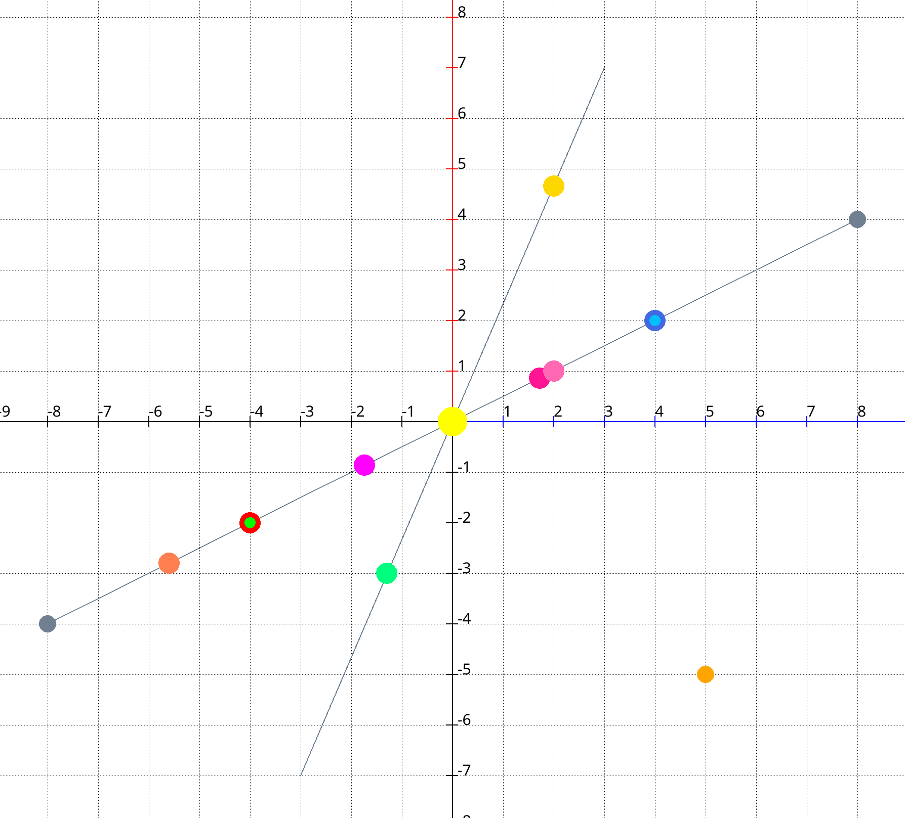

#### What each point represents

The table below lists every plotted variable, the syntax that produced it, and the exact coordinates that result from the geometry.

`s1` runs from `p1 = (-8, -4)` to `p2 = (8, 4)`, giving a total length of √(16² + 8²) ≈ 17.89.
`s2` runs from `(-3, -7)` to `(3, 7)`, giving a total length of √(6² + 14²) ≈ 15.23.

| Variable | Colour | Syntax | Result | Notes |
|---|---|---|---|---|
| `p1` | white | `point at (-8, -4)` | `(-8, -4)` | Start endpoint of s1 |
| `p2` | white | `point at (8, 4)` | `(8, 4)` | End endpoint of s1 |
| `q` | orange | `point at (5, -5)` | `(5, -5)` | External reference for nearest-to |
| `pa` | red | `point on s1 at 25% from start` | `(-4, -2)` | One quarter from p1 |
| `pb` | royalblue | `point on s1 at 25% from end` | `(4, 2)` | One quarter from p2 |
| `pc` | lime | `point on s1 at 25% from p1` | `(-4, -2)` | Same as `pa` — named endpoint form |
| `pd` | deepskyblue | `point on s1 at 25% from p2` | `(4, 2)` | Same as `pb` — named endpoint form |
| `pm` | yellow | `midpoint of s1` | `(0, 0)` | Exact centre of s1 |
| `pe` | magenta | `point on s1 at distance 7 from start` | `≈ (-1.74, -0.87)` | t ≈ 0.391 |
| `pf` | deeppink | `point on s1 at distance 7 from end` | `≈ (1.74, 0.87)` | t ≈ 0.609 |
| `pg` | coral | `point on s1 at t 0.15` | `(-5.6, -2.8)` | 15 % along s1 |
| `ph` | hotpink | `point on s1 nearest to q` | `≈ (2, 1)` | Projection of `q=(5,-5)` onto s1 |
| `pi` | gold | `point on s2 at x 2` | `≈ (2, 4.67)` | Where s2 crosses x = 2 |
| `pj` | springgreen | `point on s2 at y -3` | `≈ (-1.29, -3)` | Where s2 crosses y = -3 |

Points `pc` and `pd` are plotted at size 5 on top of `pa` (size 10) and `pb` (size 10) respectively, to visually confirm that the named-endpoint and positional forms produce the same coordinates.

---

### Angles

The `angle` type stores a rotation value. Internally it is always kept in radians, but you can enter values in degrees (the default) or radians.

#### Declaration

```
var alpha beta angle
```

#### Assignment forms

| Syntax | Meaning |
|---|---|
| `let alpha = 45` | 45 degrees (no unit → degrees by default) |
| `let alpha = 45 degrees` | 45 degrees, explicit |
| `let alpha = pi/4 radians` | π/4 radians |
| `let alpha = angle of s1` | direction of segment `s1` (`atan2(y2−y1, x2−x1)`) |
| `let alpha = angle p1 p2 p3` | interior angle at `p2` formed by the three points |

Any arithmetic expression is valid as the numeric value. The `angle of` form requires a declared `segment` variable. The three-point form returns a value in [0°, 180°].

#### Example

```
var s1 segment
var p1 p2 p3 point
var alpha beta gamma angle

let s1 = segment from (0, 0) to (3, 4)
let p1 = point at (0, 0)
let p2 = point at (4, 0)
let p3 = point at (4, 3)

let alpha = 30 degrees
let beta  = angle of s1
let gamma = angle p1 p2 p3
```

---

### Extended Segment Definitions

In addition to `segment from P to Q`, **fũnkplot** provides several extended forms that let you define a segment by its position, length, and orientation without having to compute the second endpoint by hand.

Where an angle is needed, the forms accept an angle variable or a literal angle value (with an optional `degrees`/`radians` unit; default is degrees). The word `angle` is optional, so `at angle 30 degrees` and `at 30 degrees` are the same. The length can be any expression.

#### 1. From a point, given length and angle

Places the segment starting at `P`, extending along direction `alpha` for `length` units:

```
let s = segment from P length 5 at angle alpha
let s = segment from P length 5 at angle 45 degrees
let s = segment from P length 5 at angle pi/4 radians
```

The start endpoint is `P`; the end endpoint is `P + length × (cos α, sin α)`.

#### 2. Centered at a point, given length and angle

Places the segment so that its midpoint is exactly at `P`, with the given length and direction:

```
let s = segment centered at P length 5 at angle alpha
let s = segment centered at P length 6 at angle 30 degrees
```

The start is `P − (length/2) × (cos α, sin α)` and the end is `P + (length/2) × (cos α, sin α)`.

#### 3. Through a point, parallel to a reference segment

Creates a segment centered on `P` with the same direction as `refSeg` and the given length:

```
let s = segment through P parallel to refSeg length 5
```

The angle is taken from `refSeg` using `atan2`. The resulting segment is centered on `P`.

#### 4. Through a point, perpendicular to a reference segment

Creates a segment centered on `P` perpendicular to `refSeg` with the given length:

```
let s = segment through P perpendicular to refSeg length 5
```

The angle is `atan2(refSeg) + π/2`. The resulting segment is centered on `P`.

#### 5. From a point, perpendicular to a segment

Creates the segment from `P` to the foot of the perpendicular dropped from `P` onto the line of `refSeg` (the altitude from `P`):

```
let s = segment from P perpendicular to refSeg
```

#### 6. From a point, through another point, given length

Starts at `A` and extends in the direction of `B` for the given length, which can be shorter or longer than the distance between the two points:

```
let s = segment from A through B length 5
```

#### 7. Congruent to another segment

A segment can be created with the same length as an existing segment, by placing it at a point (`from`) or centering it on a point (`centered at`), and giving its direction as an angle or as parallel or perpendicular to a segment:

```
let s2 = segment congruent to s1 from (-8, 1) parallel to s1
let s3 = segment congruent to s1 from (-1, -1) perpendicular to s1
let s4 = segment congruent to s1 centered at (5, 3) at angle 60
let s5 = segment congruent to s3 centered at (5, 0) parallel to s3
let s6 = segment congruent to s1 centered at (5, -4) perpendicular to s1
let s7 = segment congruent to s1 from P at angle alpha
```

Combined with `ticks`, this makes it easy to draw figures with congruent segments:

```
draw segment s1 ticks 1
draw segment s2 ticks 1
```

All extended forms can be followed by `as "XY"` to name the endpoints.

#### Extended segment example

```
var p q point
var s1 s2 s3 s4 s5 segment
var alpha angle

let p = point at (0, 0)
let q = point at (2, 1)
let s1 = segment from (-4, -1) to (4, 1) as "AB"

let alpha = 30 degrees

# from p at 30°, length 6 — label endpoints C and D
let s2 = segment from p length 6 at angle alpha as "CD"

# centered at q at 30°, length 4 — label endpoints M and N
let s3 = segment centered at q length 4 at angle alpha as "MN"

# through p, parallel to s1, length 6
let s4 = segment through p parallel to s1 length 6

# through q, perpendicular to s1, length 4
let s5 = segment through q perpendicular to s1 length 4

draw segment s1
draw segment s2
draw segment s3
draw segment s4
draw segment s5
```

---

### Extended Line Definitions

Besides `line through P and Q`, a line can be defined in relation to other objects. In all forms the reference can be a `segment` or a `line` variable, or a two-point name such as `AB`.

| Syntax | Meaning |
|---|---|
| `let l = line through P parallel to ref` | The line through `P`, parallel to `ref` |
| `let l = line through P perpendicular to ref` | The line through `P`, perpendicular to `ref` |
| `let l = perpendicular bisector of s` | The line perpendicular to `s`, through its midpoint |
| `let l = angle bisector A B C` | The bisector of the angle at `B` formed by the points `A`, `B` and `C` |

```
var A B C point
var s segment
var l1 l2 l3 line
let A = point at (-4, -2)
let B = point at (4, -2)
let C = point at (1, 4)
let s = segment from A to B
let l1 = line through C parallel to s
let l2 = perpendicular bisector of s
let l3 = angle bisector A B C
draw segment s
draw line l1
draw line l2
draw line l3
```

---

### Reflection of a Point

`reflected across` creates the mirror image of a point across a segment or a line. The words `segment` and `line` before the name of the mirror are optional:

```
let q = point p reflected across s as "Q"
let r = point p reflected across line l
let t = point p reflected across AB
```

---

### Measurements

The distance between two points and the length of a segment can be assigned to `number` variables:

```
var d len number
let d = distance from A to B
let len = length of segment s
let len = length of AB
```

The word `segment` after `length of` is optional.

---

### Drawing Angles

The `draw angle` statement marks an angle with an arc and writes its value in degrees next to it. A right angle is marked with a small square instead of an arc. The arms of the angle are not drawn, use `draw segment` for them. The angle can be given in the following ways:

| Syntax | Meaning |
|---|---|
| `draw angle A B C` | The angle at `B` (the middle point) between `A` and `C` |
| `draw angle ABC` | The same, using a compact name of three point names |
| `draw angle at V between A and C` | The angle at `V` between the directions of `A` and `C`; the points can also be coordinates, such as `(0, 0)` |
| `draw angle between s1 and s2` | The angle between two segments which have a common endpoint |

The following options can be added at the end, in this order: `arcs N` draws `N` concentric arcs (conventionally used to mark equal angles), a colour name sets the colour of the arcs, `double` makes them twice as thick, and `as "ABC"` draws the three points with the given labels.

```
var A B C point
let A = point at (5, 1)
let B = point at (1, 2)
let C = point at (4, 3)

set color steelblue
draw angle A B C

draw angle BAC arcs 3 red double
draw angle ACB as "ACB"
```

## Label Placement

By default **fũnkplot** draws every point label at 45° (upper-right), 12 px away from the dot. Four families of `set label` / `set labels` commands let you override every aspect of that placement, either globally or on a per-point basis.

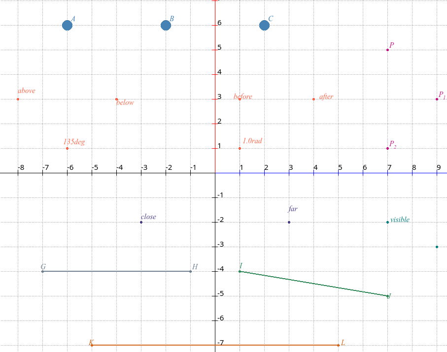

---

### `set label position`

Controls the direction in which the label is offset from the point. The setting applies to all subsequent `plot` commands until it is changed again.

```
set label position before
set label position after
set label position above
set label position below
set label position under
set label position angle <value>
set label position angle <value> degrees
set label position angle <value> radians
```

| Direction | Meaning |
|---|---|
| `before` | Directly to the left (−x direction) |
| `after` | Directly to the right (+x direction) |
| `above` | Directly upward (+y direction) |
| `below` / `under` | Directly downward (−y direction) |
| `angle <value>` | Arbitrary angle; default unit is **degrees** |
| `angle <value> degrees` | Explicit degrees |
| `angle <value> radians` | Explicit radians |

The angle is measured counter-clockwise from the positive x-axis, following the standard mathematical convention. `angle 0` is identical to `after`, `angle 90` is identical to `above`, `angle 180` is identical to `before`, and so on.

```
var pAbove pBelow pBefore pAfter pAngle point

let pAbove  = point at (-4, 3) as "A"
let pBelow  = point at ( 0, 3) as "B"
let pBefore = point at ( 4, 3) as "C"
let pAfter  = point at (-4, 1) as "D"
let pAngle  = point at ( 0, 1) as "E"

set pixel size 2

set label position above
plot pAbove

set label position below
plot pBelow

set label position before
plot pBefore

set label position after
plot pAfter

# upper-left at 135°
set label position angle 135
plot pAngle
```

---

### `set label distance`

Controls how far the label is offset from the dot, measured in screen pixels.

```
set label distance close
set label distance far
```

| Value | Pixel gap |
|---|---|
| `close` | 6 px |
| `far` | 22 px |

The default distance is 12 px, midway between the two named values. Changing the distance does not affect the direction — both settings are independent.

```
var pClose pFar point

let pClose = point at (-3, -2) as "close"
let pFar   = point at ( 3, -2) as "far"

set label position above

set label distance close
plot pClose

set label distance far
plot pFar
```

---

### `set labels on` / `set labels off`

Suppresses or restores all label rendering globally. When labels are off the dot is still drawn; only the text is hidden.

```
set labels off
set labels on
```

The effect applies from the point of the statement onward. Re-enabling with `set labels on` restores all subsequent labels.

```
var pVis pHidden point

let pVis    = point at (2, 0) as "visible"
let pHidden = point at (5, 0) as "hidden"

set label position after
set label distance close

set labels on
plot pVis        # label drawn

set labels off
plot pHidden     # dot only — no label

set labels on    # restore for subsequent statements
```

---

### `set label first … second …`

Overrides the label direction at each endpoint of a segment drawn with `draw segment`. When not set, the engine computes a geometry-driven placement (perpendicular to the segment, away from the other endpoint).

```
set label first <direction> second <direction>
```

Both `first` and `second` accept the same direction tokens as `set label position` (`before`, `after`, `above`, `below`, `under`, `angle <value> [degrees|radians]`). `first` refers to the start endpoint of the segment, `second` to the end endpoint.

Setting `first` and `second` is cumulative with `set label distance` — the pixel gap for endpoint labels is taken from the current label distance.

```
var sAB sCD sEF segment

let sAB = segment from (-7, -4) to (-1, -4) as "AB"
let sCD = segment from ( 1, -4) to ( 7, -5) as "CD"
let sEF = segment from (-5, -7) to ( 5, -7) as "EF"

set label distance close
set pixel size 2

# geometry-driven (perpendicular outward) — no override needed
set color slategray
draw segment sAB

# force A above, B below
set label first above second below
set color seagreen
draw segment sCD

# flank the endpoints horizontally
set label first before second after
set color chocolate
draw segment sEF
```

To clear the override and revert to geometry-driven placement, set the direction back to `angle 0` or use any value — the geometry mode cannot be explicitly requested; it is active whenever no `set label first/second` has been issued since the last run.

---

### Duplicate label auto-rename

When two or more points share the same label, **fũnkplot** automatically appends a numeric suffix so every label on screen is unique. The suffix starts at `1` and increments for each additional duplicate.

| Draw order | Raw label | Rendered as |
|---|---|---|
| 1st | `"P"` | P |
| 2nd | `"P"` | P1 |
| 3rd | `"P"` | P2 |

This rename happens transparently — the variable names in the script are unchanged, only the on-screen text differs.

```
var pDup1 pDup2 pDup3 point

let pDup1 = point at (7, 5) as "P"
let pDup2 = point at (9, 3) as "P"   # will appear as P1
let pDup3 = point at (7, 1) as "P"   # will appear as P2

set pixel size 10
set label position angle 45
set label distance close
plot pDup1
plot pDup2
plot pDup3
```

The rename counter resets every time the program is re-run, so the first plotted `"P"` always stays as P.

### Complete example

The following program exercises all label-placement features together. Copy it into the editor and run it to verify the rendering.

```
var pA pB pC point
var pAbove pBelow pBefore pAfter point
var pAng135 pAng1r point
var pClose pFar point
var pDup1 pDup2 pDup3 point
var pVis pHidden point
var sGH sIJ sKL segment


# ── Section 1: DEFAULT placement ─────────────────────────────────────────────
# No "set label" needed; defaults are upper-right (45°), distance 12 px.

let pA = point at (-6, 6) as "A"
let pB = point at (-2, 6) as "B"
let pC = point at ( 2, 6) as "C"

set color steelblue
set pixel size 10
plot pA
plot pB
plot pC


# ── Section 2: POSITION DIRECTIONS ───────────────────────────────────────────

let pAbove  = point at (-8,  3) as "above"
let pBelow  = point at (-4,  3) as "below"
let pBefore = point at ( 0,  3) as "before"
let pAfter  = point at ( 4,  3) as "after"
let pAng135 = point at (-6,  1) as "135deg"
let pAng1r  = point at ( 1,  1) as "1.0rad"

set color tomato
set pixel size 10

set label position above
plot pAbove

set label position below
plot pBelow

set label position before
plot pBefore

set label position after
plot pAfter

set label position angle 135
plot pAng135

set label position angle 1.0 radians
plot pAng1r


# ── Section 3: LABEL DISTANCE ─────────────────────────────────────────────────

let pClose = point at (-3, -2) as "close"
let pFar   = point at ( 3, -2) as "far"

set color darkslateblue
set pixel size 10
set label position above

set label distance close
plot pClose

set label distance far
plot pFar


# ── Section 4: SEGMENT ENDPOINT LABELS ───────────────────────────────────────

let sGH = segment from (-7, -4) to (-1, -4) as "GH"
let sIJ = segment from ( 1, -4) to ( 7, -5) as "IJ"
let sKL = segment from (-5, -7) to ( 5, -7) as "KL"

set label distance close

set color slategray
set pixel size 2
draw segment sGH                        # geometry-driven placement

set label first above second below
set color seagreen
draw segment sIJ                        # A above, B below

set label first before second after
set color chocolate
draw segment sKL                        # flanking the endpoints


# ── Section 5: DUPLICATE AUTO-RENAME ─────────────────────────────────────────
# Three points all named "P" → drawn as P, P1, P2

let pDup1 = point at (7,  5) as "P"
let pDup2 = point at (9,  3) as "P"
let pDup3 = point at (7,  1) as "P"

set color mediumvioletred
set pixel size 10
set label position angle 45
set label distance close
plot pDup1
plot pDup2
plot pDup3


# ── Section 6: LABELS ON / OFF ────────────────────────────────────────────────

let pVis    = point at (7, -2) as "visible"
let pHidden = point at (9, -3) as "hidden"

set color teal
set pixel size 10
set label position after
set label distance close

set labels on
plot pVis

set labels off
plot pHidden

set labels on
```

## Error messages

The following error messages and associated codes are used in **fũnkplot**:

| ERROR  | DESCRIPTION                                                  |
| ------ | ------------------------------------------------------------ |
| **0**  | Erroneous looping conditions detected. A loop with a negative step value, but with the start value being smaller than the end might generate this error. |
| **1**  | Invalid variable declaration. Not specifying the type of a variable might cause this error to pop up. |
| **2**  | Invalid variable type. The list of valid variable types is `number`, `point`, `segment`, `line`, `angle` and `list`. Anything else will lead to this error. |
| **3**  | Missing the keyword <b>of</b> in a statement.                |
| **4**  | Invalid list variable type.                                  |
| **5**  | Untyped lists are not supported.                             |
| **6**  | Untyped lists are not supported                              |
| **7**  | Index error                                                  |
| **8**  | Variable was not declared                                    |
| **9**  | Invalid assignment (missing assignment operator)             |
| **10** | Conflicting type assignment                                  |
| **11** | Invalid point assignment                                     |
| **12** | Conflicting type assignment: array assigned to a non array type |
| **13** | Invalid array assignment: missing <b>[</b> from the expression |
| **14** | Invalid assignment: arithmetic expression assigned to non numeric type |
| **15** | Invalid data to plot (not a point, not an indexed point, not a function) |
| **16** | Invalid function definition. Missing assignment in body      |
| **17** | Improper parametrization of the given function.              |
| **18** | Possible error in a statement. No data before a certain position. |
| **19** | Possible error in a statement. No data after a certain position |
| **20** | Syntax error in a statement. Unmatched empty parenthesis.    |
| **21** | Error in a statement. Not found enclosing parenthesis        |
| **22** | Possible error in a statement. No parameters were found for a function. |
| **23** | Possible error in statement. Meaningless use of a function.  |
| **24** | Possible error in statement. No parameters for a function.   |
| **25** | Invalid plotting interval                                    |
| **26** | Possible error in statement. Improper power expression.      |
| **27** | Possible error in formula. Looks like an invalid statement.  |
| **28** | Possible error in a statement. No data before a certain position. |
| **29** | Possible error in a statement. No data after a certain position. |
| **30** | Possible error in a statement. The statement is not fully understood. |
| **31** | Unknown pixel property, or the expression is nested too deeply (maximum recursion depth exceeded). |
| **32** | Wrong palette indexing                                       |
| **33** | Invalid color to set.                                        |
| **34** | Cannot identify the object assigning from                    |
| **35** | Invalid statement. The line does not start with a known keyword, or the statement is malformed. |
| **36** | Syntax error: unsupported <b>set</b> target.                 |
| **37** | Undeclared variables cannot be used in for loops.            |
| **38** | <b>for</b> statement with direct assignment does not contain the to keyword |
| **39** | Invalid for statement.                                       |
| **40** | <b>for</b> statement does not contain the do keyword.        |
| **41** | Internal error from the underlying libraries                 |
| **42** | Invalid expression                                           |
| **43** | <b>for</b> body does not end with <b>done</b>.               |
| **44** | rotate statement tries to rotate undeclared variable         |
| **45** | rotate statement does not contain <b>with</b> keyword        |
| **46** | Rotation unit must be either degree or radians (default)     |
| **47** | Unknown keyword in rotation.                                 |
| **48** | Invalid reference: (missing **at** keyword)                  |
| **49** | A value was declared and used but not defined to hold a value. Also reported when a segment or a line is used before its defining `let` statement was executed, or when its definition could not be computed. |
| **50** | Cannot plot a number                                         |
| **51** | Invalid assignment missing of keyword                        |
| **52** | No such function                                             |
| **53** | Invalid or missing keyword, such as a missing `and` in a line or intersection definition. |
| **54** | A keyword is missing from a geometric definition, such as `to`, `at`, `length` or `across`. |
| **55** | Index out of bounds                                          |
| **56** | Invalid index (ie: the resulted index is negative).          |
| **57** | Cannot identify the object to assign to.                     |
| **58** | Incompatible assignment types don't match.                   |
| **59** | Append statement does not contain the TO keyword             |
| **60** | No function for **points of** assignment                     |
| **61** | Cannot assign a non numeric value to a numeric variable      |
| **62** | Cannot identify the object assigning from                    |
| **63** | Unsupported list domain in an `append` statement (only `numbers` and `points` are supported) |
| **64** | Cannot identify the assignment source                        |
| **65** | Cannot use a point type variable in that context             |
| **66** | Missing <b>begin</b> keyword from `python` scriptlet         |
| **67** | Missing the <b>script</b> or <b>do</b> keyword from `python` scriptlet |
| **68** | Internal error of the python interpreter                     |
| **69** | Invalid parametric function definition: missing `function` keyword or parenthesis |
| **70** | Invalid parametric function definition: only the coordinates `x` and `y` are supported |
| **71** | Invalid parametric function definition: missing `=` sign     |
| **72** | Missing keyword `to` in a `point on … nearest to` assignment |
| **73** | Missing keyword `from` in a `point on … at distance` or percentage assignment |
| **74** | Expected a percentage (e.g. `25%`) in a point-on-segment assignment |
| **75** | Expected `at` or `nearest` in a point-on-segment assignment  |
| **76** | Missing keyword `of` in a `midpoint` assignment              |
