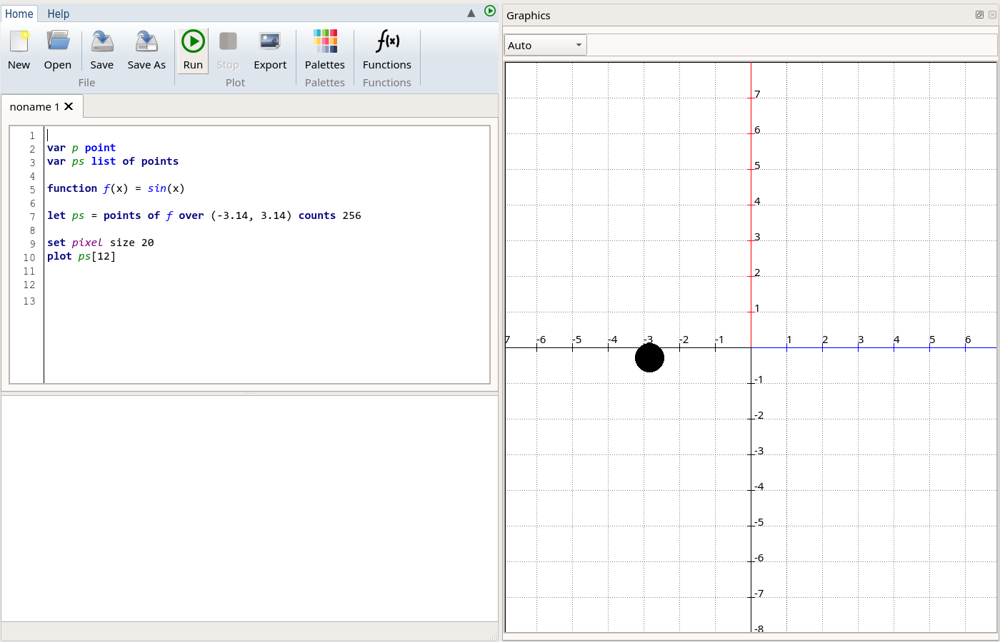
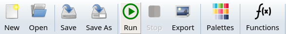
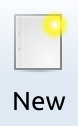
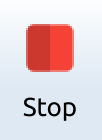
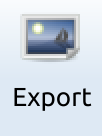
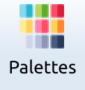
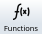
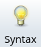

## The **fũnkplot** GUI

We tried to make the **fũnkplot** gui as simple and easy to use as possible. Starting the application will greet you with the following screen:

On the top of the screen there is the toolbar, with the **Home** and **Help** tabs, holding various buttons that by pressing will activate a specific functionality, as described below.

Below the toolbar is the programming area, with a tabbed interface, each program resides in its own tab page, and you can have several of these open.

Below the programming area there is the output window, here you will get feedback about the running program.

On the right of the screen there is the visualization area (the **Graphics** panel), which can be zoomed in using the mouse wheel, and by pressing and holding the mouse you can change the position of the coordinate system. The panel can be detached from the main window and floated using the buttons in its title bar. The drop-down list above the drawing sets the size of the drawing area: `Auto` fills the available space, while one of the fixed sizes (from 640 x 480 up to 1920 x 1080) gives a drawing with exactly that size, which is useful when exporting the image.

### The toolbar

The following is the **Home** tab of the toolbar of the application:

The following functionality is hidden behind the icons:

| Icon                                                         | Description                                                  |
| ------------------------------------------------------------ | ------------------------------------------------------------ |
|  | Pressing this button will create a new program, and will add a new Tab page in the programs section. |
|  | Will open a **fũnkplot** program, with the extension `fnk` . |
|  | Saves the current program to the disk. If the program was not saved before it will ask for a filename and location. The extension used for a **fũnkplot** program is `fnk`. |
|  | Saves the current program using a different name.            |
|  | Runs the currently selected program. The content of the plot area is cleared, the scene is set up using the settings from the current code and the code lines are interpreted then executed one after the other. |
|  | Stops the execution of the currently running program. If a calculation takes a very long time, and you ran out of patience this is the button for you. |
|  | This will export the current contents of the plot area’s viewport (ie: the image, after you have zoomed and positioned the drawing with the mouse) into a graphics file of your choice. |
|  | This will open the palette chooser window, from where you can copy the name of your favourite palette into the program. |
|  | Opens the menu of the built-in curves, organized by categories (such as roulettes, conic sections or spirals). Choosing a curve shows its formula, its plot and its parameters, which can be changed, and then the code drawing the curve can be inserted into the current program. The Function database section of this help describes all the built-in curves. |

The **Help** tab of the toolbar contains the following buttons:

| Icon                                                         | Description                                                  |
| ------------------------------------------------------------ | ------------------------------------------------------------ |
|  | Opens this help.                                             |
|  | Shows the about window of **fũnkplot**, with its copyright notice. Clicking the window closes it. The license and the 3rd party software are described in the About section of this help. |

The small arrow on the right side of the tabs hides or shows the buttons of the toolbar, and the green button next to it runs the current program, just like the **Run** button.

