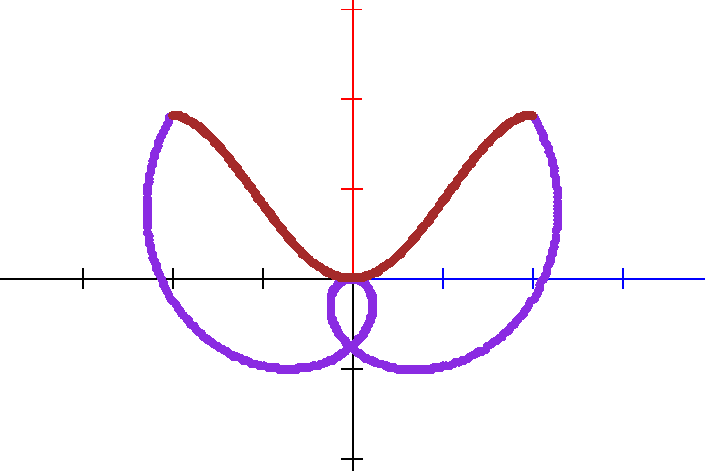

## The **for** keyword

The `for` keyword is used to declare a loop that will execute a block of code a specific time. There are two forms a `for` loop can take in **fũnkplot**. The first one is a standard numeric loop:

```
var i number
for i = 1 to 5 do
  python script begin
    print(i)
  end
done
```

This will declare a variable `i`, and execute the body of the loop 5 times, which is calling a one line python script printing the value of i. The loop variable has to be declared before the loop. The output should look like:

```
1.0
2.0
3.0
4.0
5.0
```

By default the loop variable is increased by `1`, a different increment can be specified with the `step` keyword:

```
var i number
var p point
for i = 0 to 2 step 0.5 do
  let p = point at (i, i)
  plot p
done
```

### Looping through a range

The same numeric loop can be written with the `range` keyword, where the start and the end values are given in parentheses, optionally followed by a `step`:

```
var i number
var p point
for i in range (0, 5) step 1 do
  let p = point at (i, i * i / 5)
  plot p
done
```

### Looping through a list

The other form of the `for` loop is when looping through a list. This looks like:

```
var i number
var l list of numbers
let l = list [1,5,10,15]
for i in l do
  python script begin
    print(i)
  end
done
```

This will generate the following output:

```
1.0
5.0
10.0
15.0
```

### Looping through the points of a function

The `for` loop can be used to loop through the points of the plot of a function, and it will make possible to perform various operations on individual points, like in the example below:

```
set pixel size 2
var a number
var p point
var ps list of points

function f(x) = x * sin(x)

let ps = points of f over (-2,2) counts 360
let a = 0

set color blueviolet
for p in ps do
  rotate p with a degrees
  let a = a + 1
  plot p
done

set color brown
plot ps
```

This will generate the following image:



