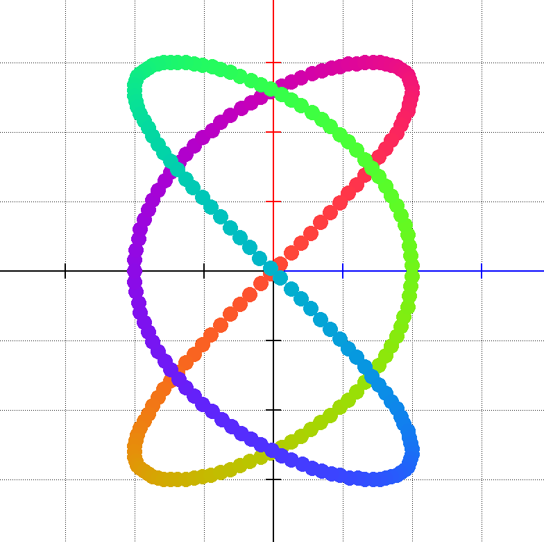

## The **function** keyword

The `function` keyword is used to declare the mathematical functions you intend to plot. The syntax is:

```
function f(x) = expression
```

Functions can have more than one parameter, separated by commas, for example `function f(x, y) = (x + y) / 3`. Parameter names must be valid identifiers: a letter or `_` followed by letters, digits or `_`.

The expression might consist of any of the following terms, even combined with one another:

- mathematical operators:
  - `+` (addition)
  - `-` (subtraction)
  - `/` (division)
  - `*` (multiplication)
  - `%` (modulo)
  - `^` (power)
- parentheses `(` and `)` to denote the precedence of operations
- algebraical and trigonometrical functions:
  - `sin` (The sine function)
  - `cos` (The cosine function)
  - `tan` (The tangent function)
  - `cot` (The cotangent function)
  - `sec` (The secant function)
  - `cosec` (The cosecant function)
  - `asin` (The arcsine function)
  - `acos` (The arccosine function)
  - `atan` (The arctangent function)
  - `actg` (The arc-cotangent function)
  - `asec` (The arcsecant function)
  - `acosec` (The arc-cosecant function)
  - `sinh` (The hyperbolic sine function)
  - `cosh` (The hyperbolic cosine function)
  - `tanh` (The hyperbolic tangent function)
  - `coth` (The hyperbolic cotangent function)
  - `exp` (The exponential function)
  - `log` (The common logarithmic function)
  - `ln` (The natural logarithmic function)
  - `sqrt` (The square root function)
  - `abs` (The absolute value)
  - `sgn` (The sign function: `-1`, `0` or `1`)
  - `inc` (Adds one to its argument)
  - `dec` (Subtracts one from its argument)
- another function you have declared with one parameter, for example `function f(x) = g(x) + 1`
- a variable defined in the `var` section of the application
  - This situation will bind a reference to the variable into the body of the function, so each evaluation of the functions’ values reflects the state of the variable used in it
  - The coordinates of a point variable can be accessed with `.x` and `.y`, such as `p.x`, and the elements of a list with an index, such as `ps[2].y`

The order of evaluation of the operators is a mathematical one.

It is possible to declare more than one function in a program.

### Powers of functions

A built-in function can be raised to a power by writing the power after the name of the function, as is customary in mathematics. The following two functions are identical:

```
function f(x) = sin^2(x) + cos^2(x)
function g(x) = sin(x)^2 + cos(x)^2
```

### Constants

The following constants can be used in expressions:

| Constant      | Value                                        |
| ------------- | -------------------------------------------- |
| `pi` or `π`   | 3.141592653589793                            |
| `e` or `ℯ`    | 2.718281828459045 (unless a parameter of the function is called `e`) |

Also, the superscript `²` is understood as a power of two, so `x²` is the same as `x^2`.

### Comparisons and logical operations

Expressions can contain the comparison operators `==`, `!=`, `<`, `<=`, `>` and `>=`, and the logical operators `and`, `or` and `not`. A comparison evaluates to `1` if it is true and to `0` otherwise. `not` binds weaker than the comparisons, so `not x > 0` means `not (x > 0)`, `and` binds stronger than `or`, and parentheses can be used to change the order. These are mostly useful in the conditions of the `if` statement, but they can be used in functions too, even as a part of an arithmetic expression:

```
function f(x) = x > 0 and x < 1 or x == 2
function g(x) = (x % 2 == 0) * 10 + not(x > 5)
```

### Example

The following code plots a colourful Lissajous curve by defining two functions:

```
set palette firestrm
set pixel size 5

var pssin pscos list of points
var i x y number
var ps pc p point
let i = 0
function ps(x) = 2 * sin(3 * x + 3.14/2)
function pc(x) = 3 * sin(2 * x)

let pssin = points of ps over (-3.14, 3.14) counts 256
let pscos = points of pc over (-3.14, 3.14) counts 256

for i = 0 to 255 do

  let ps = pssin[i]
  let pc = pscos[i]

  let x = ps.y
  let y = pc.y

  let p = point at (x,y)
  set color palette[i]
  plot p

done
```

Resulting in the following plot:



### Parametric functions

A parametric function defines the `x` and `y` coordinates of a curve separately, as functions of one parameter. It is declared with `parametric function`, followed by one line for each coordinate, and closed with `end` (or `done`):

```
parametric function name(t)
  x = expression of t
  y = expression of t
end
```

Only the coordinates `x` and `y` are supported in the body. A parametric function can be plotted, or its points can be assigned to a list, just like the points of a normal function. The following program draws an astroid:

```
var a number
let a = 2
parametric function f(t)
  x = a * cos^3(t)
  y = a * sin^3(t)
end
plot f over (-3.14, 3.14)
```
