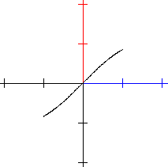
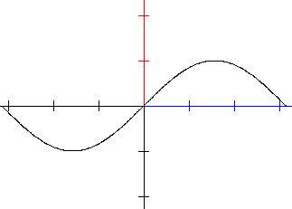
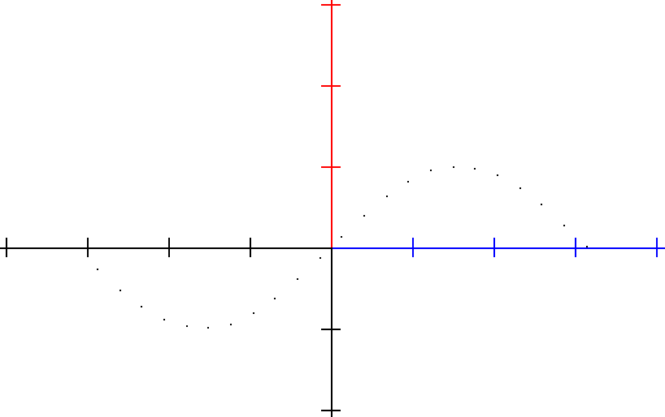
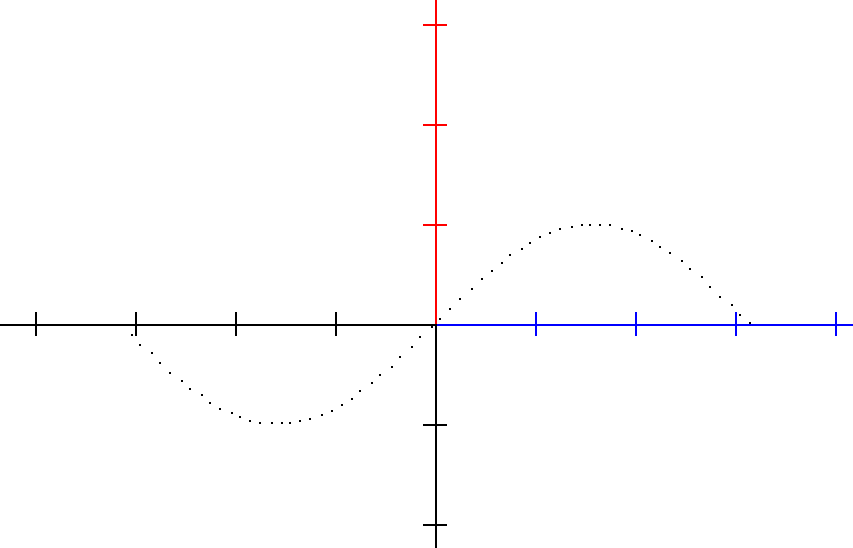

## The **let** keyword

The `let` keyword is used to make an assignment to a declared variable. It’s basic syntax is:

```
var a number
let a = 1.2
```

This will assign the value `1.2` to the variable `a`, which was declared to be of type `number`. It will raise a syntax error to assign to a variable which was not declared, or if the type is different.

It is possible to assign arithmetic expressions to numeric type variables, so the following is syntactically correct:

```
var a b c number
let a = 1.2
let b = 2.3
let c = a + b
```

### Creating a point

The `let` keyword is also used to create a point on the scene.

The following assignment assigns to the `point` type variable called `p` the point at `(1,2)` and plots it, the result is a small dot, indicating the point has been drawn.

```
var p point
let p = point at (1,2)
plot p
```

#### Naming a point

Any point assignment can be followed by `as "NAME"` to attach a label that will be drawn next to the point on the scene:

```
var p point
let p = point at (1, 2) as "P"
plot p
```

The label is drawn in an italic serif font to match conventional mathematical notation. If the name ends with one or more digits, those digits are rendered as a subscript automatically — so `"P1"` appears as *P* with a small *1* below the baseline, `"A12"` as *A* with *12* below, and so on.

```
var p1 p2 point
let p1 = point at (-2, 0) as "P1"
let p2 = point at ( 2, 0) as "P2"
plot p1
plot p2
```

When two or more named points share the same screen position their labels are stacked vertically so they do not overlap.

The `as "NAME"` suffix works on all point-producing forms of `let`, not only `point at`:

```
let p = point on s at 25% from start as "A"
let q = point on s at t 0.5         as "M"
let r = point on s at x 3           as "R1"
let i = point at intersection of s1 and s2 as "I"
let m = midpoint of s as "M"
let q = point p reflected across s as "Q"
```

#### Copying a point

A point can be assigned from another point, or from an element of a list of points. The coordinates of a point can be used in arithmetic expressions with `.x` and `.y`:

```
var p q point
var ps list of points
var a number
function f(x) = x * x
let ps = points of f over (-2, 2) counts 10
let p = ps[3]
let q = p
let a = q.x + q.y
```

#### Geometric constructions

Many more point, segment, line and number assignments are available for geometric constructions, such as the point on a segment, the intersection of two lines, the reflection of a point, the distance between two points or the length of a segment. These are described in the Geometric objects section of this help.

### The points of a function

The `let` keyword can be also used to assign the points of a drawable object (such as a function) to a variable which can be manipulated in various ways.

The following piece of code will create such a variable:

```
var ps list of points
function f(x) = sin(x)
let ps = points of f 
plot ps
```

and running it will result in the following drawing:



The algorithm operating on the default interval `[-1, 1]` is a simple iterative one, that starts `x` from the first point in the default drawing interval (`-1`) till the end of the default drawing interval (`1`) and will use a default step of `0.01` for advancing the function drawing, while calculating the value `f(x)` as per the mathematical formula of the function.

#### Advanced points assignment

Since there can be situations where we want to plot functions outside of the default `[-1, 1]` interval, the `let` keyword accepts extra parameters too, specifying the interval, the number of points or segments we want to draw and whether we want to plot using points of function or a continuous drawing.

##### Specifying the interval

The following example specifies the interval which is to be used to draw the function:

```
var ps list of points
function f(x) = sin(x)
let ps = points of f over (-3.14, 3.14)
plot ps
```

and results in the following plot:



##### Specifying the number of points in a plot

It is possible to specify how many points should a drawing contain to have a better control over your data using the `counts` keyword. The following example specifies the number of points that will be used to draw the function:

```
var ps list of points
function f(x) = sin(x)
let ps = points of f over (-3.14, 3.14) counts 24
plot ps
```

and results in the following plot:



This approach will calculate the step value considering the length of the interval to obtain the required number of points.

##### Specifying the step used in a plot

It is possible to specify the step used when drawing the plot of the function using the `step` keyword. The following example specifies the steps that will be used to draw the function:

```
var ps list of points
function f(x) = sin(x)
let ps = points of f over (-3.14, 3.14) step 0.1
plot ps
```

and results in the following plot:



Since the step is calculated based on the number of points, it is not possible to specify both the steps and the number of points.

The points of parametric functions, segments and lines can be assigned the same way, for example `let ps = points of s counts 10` for a segment `s`. For lines, which are infinite, the interval has to be specified with `over`.

### A list of numbers

A list of numbers is assigned with the `list` keyword, followed by the numbers in square brackets. Individual elements can be changed by indexing the variable, the index of the first element is `0`:

```
var xs list of numbers
let xs = list [1, 2, 3, 4]
let xs[2] = 9
```

### A list of points

The `let` keyword can be used to make an assignment to a list of points by using predefined values. The points can be separated by `;` or `,`.

```
var ps list of points
let ps = list [(1,2);(3,4)]
```

This will assign the two points at `(1,2)` and `(3,4)` to the `ps` variable. An empty list can be created with `let ps = list[]`, and points can be added to it later with the `append` keyword.

### Assigning an Angle

Angle variables store a rotation in radians internally but can be entered and displayed in degrees.

#### Literal angle value

The simplest form assigns a numeric literal; with no unit the value is interpreted as **degrees**:

```
var alpha angle
let alpha = 45
```

The unit keyword can be given explicitly:

```
let alpha = 45 degrees
let alpha = pi/4 radians
```

Any arithmetic expression is accepted as the value:

```
let alpha = 360 / 8 degrees
```

#### Angle of a segment

Assigns the direction angle of a named segment — the angle that the segment makes with the positive x-axis, computed as `atan2(y2−y1, x2−x1)`:

```
var s1 segment
var alpha angle
let s1 = segment from (0, 0) to (3, 4)
let alpha = angle of s1
```

#### Angle between three points

Computes the interior angle at the middle (vertex) point, formed by three named points. The result is always in the range [0°, 180°]:

```
var p1 p2 p3 point
var beta angle
let p1 = point at (0, 0)
let p2 = point at (3, 0)
let p3 = point at (3, 4)
let beta = angle p1 p2 p3
```

This uses the dot-product formula: `arccos((v1 · v2) / (|v1| |v2|))` where `v1 = p1 − p2` and `v2 = p3 − p2`.