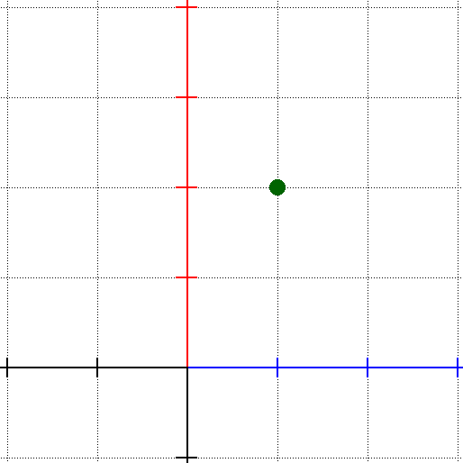
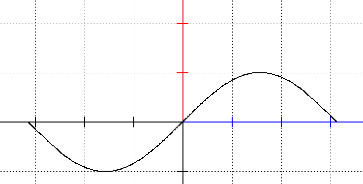
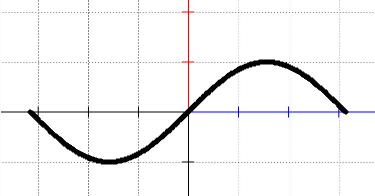
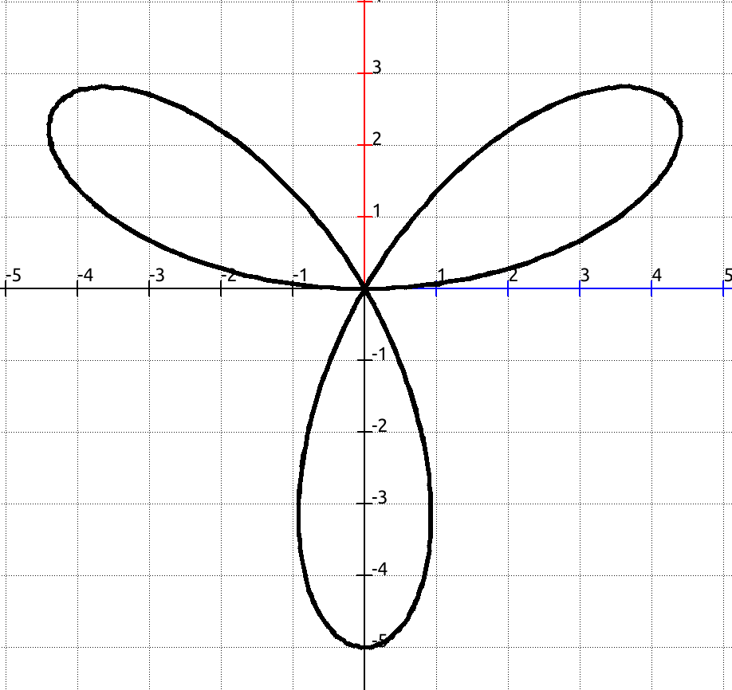

## The **plot** keyword

The `plot` keyword is used to draw the graphical representation of an expression. The colour, and the pixel size for the plot can be specified using the `set` keyword.

### Plotting a point

The following program plots one point on the screen:

```
set color darkgreen
set pixel size 4
var p point
let p = point at (1, 2)
plot p
```

Generating the following plot:



### Plotting a function

The following code plots the function `sin(x)` over the interval `(-π, π)`.

```
function f(x)=sin(x)
plot f over (-3.14, 3.14)
```

For plotting functions it is possible to specify the plot interval and the type of the plot (ie. a continuous plot, the increase step or the number of points used to represent the drawing):

| Specifier          | Meaning                                                      |
| ------------------ | ------------------------------------------------------------ |
| `over (a, b)`      | The interval of the plot.                                    |
| `continuous`       | Connects the calculated points with lines, instead of drawing them as separate points. |
| `counts N`         | Uses `N` points, evenly distributed over the interval.       |
| `step S`           | Advances with `S` between two calculated points.             |

If there is no plot interval, the default interval of `(-1, 1)` is used. If there is no step or point count defined the default step of `0.01` is used.

The program above will generate the following image:



### Plotting an expression directly

It is not necessary to declare a function in order to plot it. A built-in function can be plotted by its name, and any expression can be plotted with the `for` specifier, which names the variable of the expression (if there is no `for`, the variable is `x`):

```
plot sin over (-3.14, 3.14) continuous
plot x^2 - 1 for x over (-2, 2) continuous
plot sin(t) * t for t over (-6, 6) continuous
```

Built-in functions written without parameters are applied to the variable, so `plot sin * x for x over (-3, 3)` is the same as `plot sin(x) * x for x over (-3, 3)`.

### Plotting a parametric function

Parametric functions (see the `function` keyword) are plotted the same way as normal functions, the interval refers to the parameter of the function:

```
parametric function f(t)
  x = 2 * cos(t)
  y = sin(t)
end
plot f over (0, 6.28)
```

### Plotting geometric objects

Points, and also `segment` and `line` variables can be plotted with `plot`. Points that were given a name with `as "NAME"` are plotted together with their label. More options for geometric objects are available with the `draw` keyword, see the Geometric objects section of this help.

```
var p point
var s segment
let p = point at (1, 1) as "P"
let s = segment from (0, 0) to (4, 2)
plot p
plot s
```

### Plotting the points of a function

It is possible to plot the points of a function while iterating over them with an index counter, or by point reference.

```
set pixel size 2
var p point
var ps list of points

function f(x) = sin(x)

let ps = points of f over (-3.14, 3.14)

for p in ps do
  plot p
done
```

Generating the following plot:



### Plotting polar data

**funkplot** can interpret the data to be plotted as a series of polar data if you precede it with the `polar` keyword. The following program:

```
set pixel size 3
function f(x) = 5* sin(3 * x) 
polar plot f  over (0, 6.28) continuous
```

will generate the following graph:


